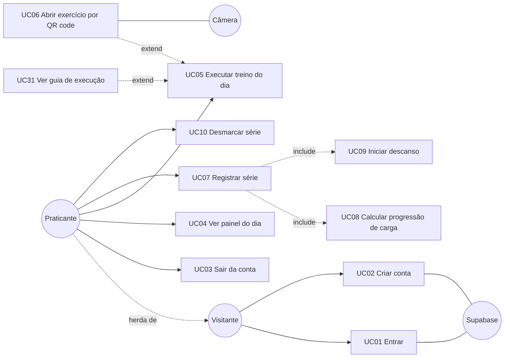
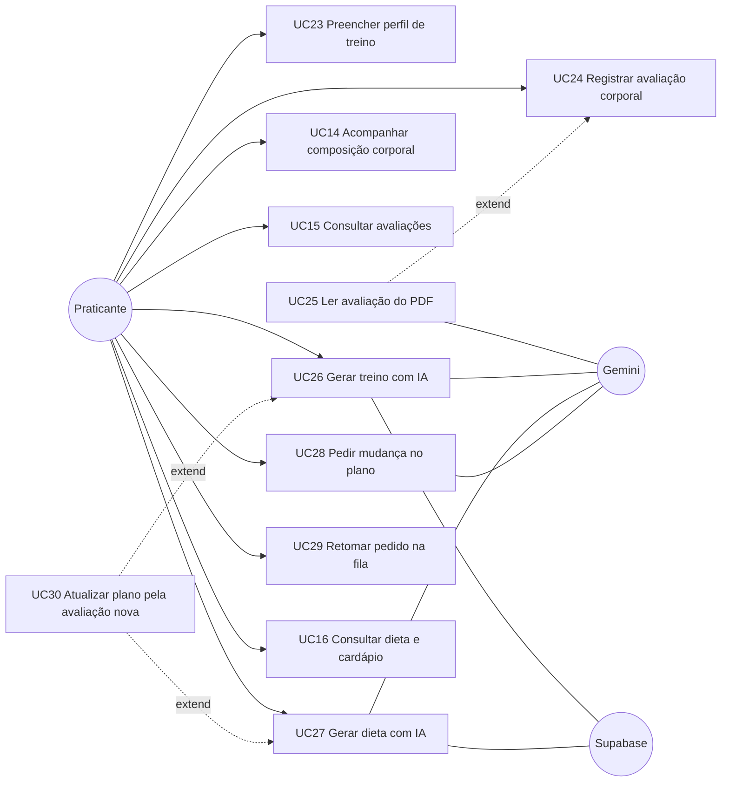
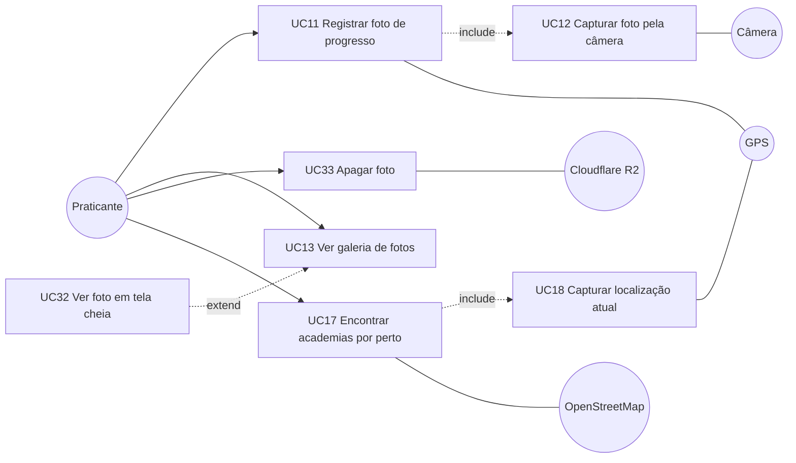
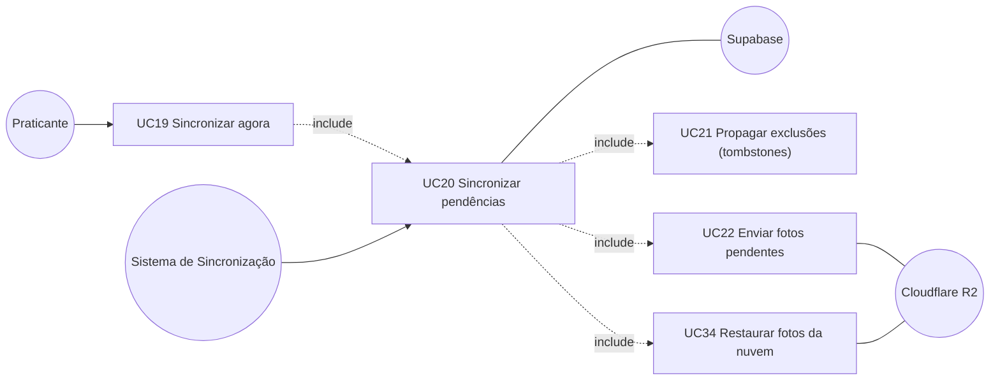
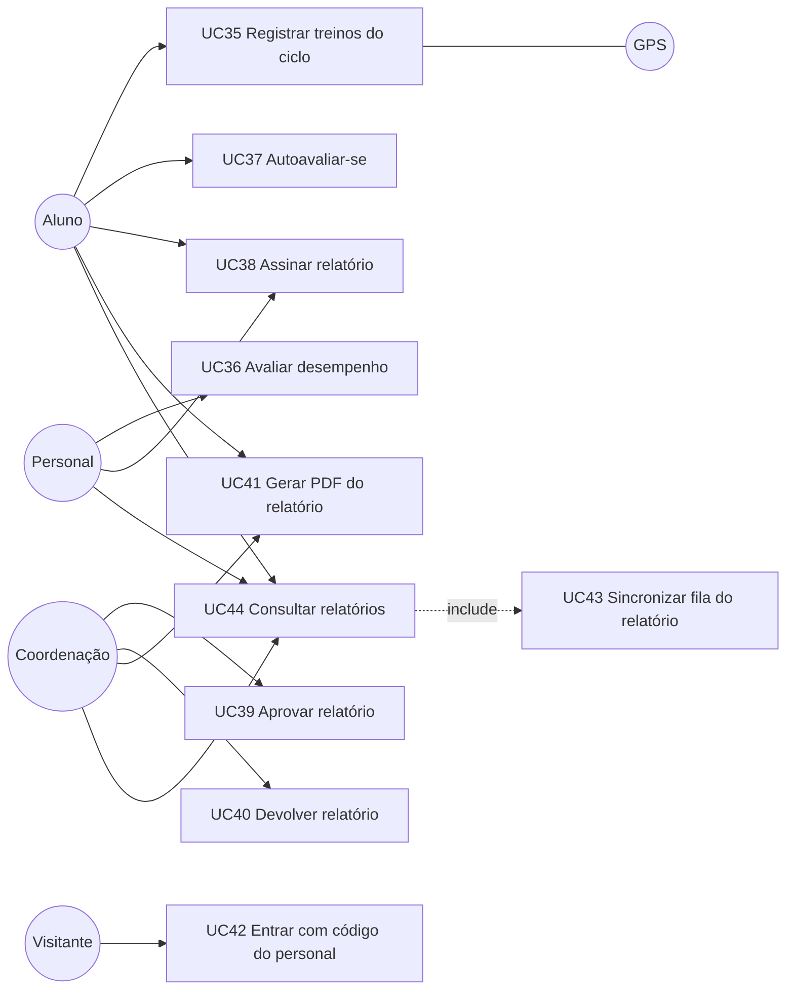

# 2 · Diagrama de Casos de Uso

[← Requisitos](01-requisitos.md) · [Índice](README.md) · [Próximo: Classes e dados →](03-classes-e-dados.md)

## Atores

| Ator | Tipo | Papel |
|---|---|---|
| **Visitante** | Pessoa | Abre o app sem sessão. Só alcança Entrar, Criar conta e Entrar com código. |
| **Praticante (aluno)** | Pessoa, **herda de Visitante** | Visitante com sessão válida. É o dono de todos os dados de treino, avaliação, planos e fotos. No relatório do ciclo, o papel dele é `aluno`. Herda os casos de uso de autenticação: o `Stack.Protected` esconde login e cadastro enquanto a sessão existe, e eles voltam ao sair da conta. |
| **Personal** | Pessoa | Acompanha o aluno no relatório do ciclo: avalia e assina. Entra com conta própria (papel `personal` no `user_metadata`) ou, sem conta, pelo código que o aluno gerou. |
| **Coordenação** | Pessoa | Aprova ou devolve o relatório assinado. Vê os relatórios de todos. |
| **Sistema de Sincronização** | Ator de tempo / background | O hook `useWorkoutSync`, disparado ao abrir a área logada, na reconexão (NetInfo) e na volta ao primeiro plano (AppState). |
| **Supabase** | Sistema externo | Auth, Postgres, Storage (PDF da avaliação) e Edge Functions (`generate-plan`, `extract-assessment`, `photo-storage`). |
| **Gemini (Google AI Studio)** | Sistema externo | Modelo de IA que propõe o treino e a dieta e lê o PDF da avaliação. Só é chamado pelas Edge Functions. |
| **Cloudflare R2** | Sistema externo | Onde ficam os arquivos das fotos de progresso. O app envia e baixa por URL assinada. |
| **OpenStreetMap (Overpass e Nominatim)** | Sistema externo | Fontes das academias por perto, em cadeia: Overpass principal, Nominatim, espelhos do Overpass. |
| **Administrador** | Pessoa, fora do app | Recebe pelo ntfy o aviso de que a nuvem de fotos passou de 80% ou encheu. |
| **Câmera do dispositivo** | Hardware | Foto de progresso e leitura de QR. |
| **GPS do dispositivo** | Hardware | Posição para a busca de academias, local da foto e check-in do treino do ciclo. |

> A **aplicação web** (Next.js, em `apps/web`) também fala com o mesmo Supabase, mas não é mais a origem dos dados do mobile. Avaliação, treino e dieta agora nascem no próprio app. O pipeline antigo do web (PDF → Claude → plano) depende de chave paga e está parado (ver [lacunas](10-implementacao.md#lacunas-e-próximos-passos)).

## Diagramas

Divididos em cinco recortes para caber na tela. Os ids (UCxx) são únicos no documento todo; os de UC01 a UC22 vêm da primeira versão e foram mantidos.

### 2.a Conta e treino



### 2.b Avaliação e planos gerados por IA



### 2.c Fotos e academias



### 2.d Sincronização



### 2.e Relatório do ciclo de treino



### Notação textual

```
Ator: Visitante
Ator: Praticante / Aluno (herda de Visitante)
Atores: Personal, Coordenação (módulo de relatórios do ciclo)
Ator: Sistema de Sincronização (ator de tempo/background)
Atores externos: Supabase, Gemini, Cloudflare R2, OpenStreetMap, Câmera, GPS
Ator fora do app: Administrador (aviso pelo ntfy)

UC01 Entrar
UC02 Criar conta
UC03 Sair da conta
UC04 Ver painel do dia                      (local + remoto)
UC05 Executar treino do dia                 (offline, plano em cache)
  <<extend>> UC06 Abrir exercício por QR code  (ponto de extensão: escolher exercício)
  <<extend>> UC31 Ver guia de execução         (ponto de extensão: tela do exercício)
UC07 Registrar série                        (offline)
  <<include>> UC08 Calcular progressão de carga
  <<include>> UC09 Iniciar descanso
UC10 Desmarcar série                        (offline)
UC11 Registrar foto de progresso            (offline)
  <<include>> UC12 Capturar foto pela câmera
UC13 Ver galeria de fotos                   (offline)
  <<extend>> UC32 Ver foto em tela cheia
UC33 Apagar foto                            (offline; nuvem depois)
UC14 Acompanhar composição corporal         (online)
UC15 Consultar avaliações                   (online)
UC16 Consultar dieta e cardápio             (online)
UC17 Encontrar academias por perto          (online, com última busca guardada)
  <<include>> UC18 Capturar localização atual
UC19 Sincronizar agora                      (Praticante)
  <<include>> UC20
UC20 Sincronizar pendências                 (Sistema de Sincronização)
  <<include>> UC21 Propagar exclusões (tombstones)
  <<include>> UC22 Enviar fotos pendentes
  <<include>> UC34 Restaurar fotos da nuvem
UC23 Preencher perfil de treino             (online)
UC24 Registrar avaliação corporal           (online)
  <<extend>> UC25 Ler avaliação do PDF       (ponto de extensão: preencher formulário)
UC26 Gerar treino com IA                    (online)
UC27 Gerar dieta com IA                     (online)
  <<extend>> UC30 Atualizar plano pela avaliação nova (ponto de extensão: abrir Treino/Nutrição)
UC28 Pedir mudança no plano                 (online)
UC29 Retomar pedido na fila                 (online)
UC35 Registrar treinos do ciclo             (Aluno)
UC36 Avaliar desempenho                     (Personal)
UC37 Autoavaliar-se                         (Aluno)
UC38 Assinar relatório                      (Aluno, Personal)
UC39 Aprovar relatório                      (Coordenação)
UC40 Devolver relatório                     (Coordenação)
UC41 Gerar PDF do relatório                 (Aluno, Coordenação)
UC42 Entrar com código do personal          (Visitante)
UC43 Sincronizar fila do relatório
UC44 Consultar relatórios                   (todos)
  <<include>> UC43
```

`UC08` e `UC09` são *include* porque acontecem **sempre** que uma série é registrada: a carga anterior é lida e o descanso dispara. `UC06` e `UC31` são *extend* porque são atalhos opcionais, já que o treino funciona inteiro pela lista. `UC25` é *extend* do `UC24` porque a leitura do PDF só preenche o formulário: quem salva é sempre o `UC24`, depois de a pessoa conferir os números. `UC30` estende a geração porque só aparece quando chega uma avaliação mais nova que a do plano, e mesmo assim nunca gera sozinho.

## Descrição textual dos casos de uso principais

### UC01 — Entrar

| | |
|---|---|
| **Ator** | Visitante |
| **Pré-condição** | Sem sessão salva no aparelho. |
| **Fluxo principal** | 1. Visitante informa e-mail e senha e toca "Entrar". 2. `AutenticarUsuarioUseCase` valida o formato do e-mail e a presença de senha. 3. `AuthGateway` (Supabase Auth) autentica e devolve a `Sessao` já traduzida para o domínio, com o papel lido do `user_metadata`. 4. A sessão é guardada pelo `SessionStorage` (Keychain/Keystore) e o `Stack.Protected` troca para a área logada. |
| **Alternativo A1 — dado inválido** | Em 2, e-mail malformado ou senha vazia: a mensagem aparece **sem ida à rede**. |
| **Alternativo A2 — credencial recusada** | Em 3, "E-mail ou senha inválidos." ou "Confirme seu e-mail pelo link que enviamos". |
| **Alternativo A3 — sem rede** | Em 3, o provedor não responde (modo avião, DNS, projeto pausado): "Sem conexão com o servidor. Confira sua internet…". O app **não** culpa a senha. |
| **Pós-condição** | Sessão persistida; as próximas aberturas entram direto pelo `RestaurarSessaoUseCase`, inclusive offline (RF04). |

### UC02 — Criar conta

| | |
|---|---|
| **Ator** | Visitante |
| **Pré-condição** | Sem sessão. |
| **Fluxo principal** | 1. Informa e-mail, senha e confirmação. 2. `SignUpUseCase` valida e-mail, tamanho mínimo (6) e igualdade das senhas. 3. `AuthGateway` cria a conta. 4. Com sessão imediata, entra na área logada. |
| **Alternativo A1 — confirmação de e-mail** | Em 4, o projeto exige confirmação: a conta nasce sem sessão; o app mostra "Enviamos um link de confirmação" e para de carregar. |
| **Alternativo A2 — recusa** | E-mail já cadastrado, senha fraca, limite de tentativas ou sem rede: mensagem específica. |
| **Pós-condição** | Conta criada no Supabase Auth. |

### UC05 — Executar treino do dia

| | |
|---|---|
| **Ator** | Praticante |
| **Pré-condição** | Sessão válida. |
| **Fluxo principal** | 1. Abre a aba Treino. 2. `LoadActiveWorkoutPlanUseCase` busca o treino ativo no Supabase e atualiza a cópia no SQLite. 3. `indiceDoTreinoDeHoje` escolhe o dia: o mesmo de hoje, se já houve série hoje; senão, o dia seguinte ao da última sessão que bate com o plano. 4. `montarTreinoDoDia` monta o `Workout` com a meta de carga de cada série igual à maior carga da última sessão do exercício. 5. A tela mostra os exercícios com o progresso de séries; a pessoa pode trocar de dia nas pílulas. |
| **Alternativo A1 — sem rede** | Em 2, sem conexão ou servidor fora: o caso de uso devolve a cópia do aparelho, e o treino abre igual (RF30). |
| **Alternativo A2 — sem treino** | Não existe plano ativo: a tela oferece "Gerar meu treino" (UC26); se faltar o perfil, a recusa traz o atalho "Preencher perfil de treino". |
| **Pós-condição** | Nenhuma escrita; a cópia local fica em dia com o servidor. |

### UC07 — Registrar série (com UC08 e UC09)

| | |
|---|---|
| **Ator** | Praticante |
| **Pré-condição** | Sessão válida; migrations do SQLite aplicadas no boot; exercício aberto. |
| **Fluxo principal** | 1. Ajusta a carga no stepper (±2,5 kg). 2. Toca o check da série. 3. `RegisterSetUseCase` lê a última carga do exercício no SQLite (UC08), cria o `SetLog` com UUID do cliente e status `pending` e grava. 4. A tela marca a série (háptico + animação), mostra o delta de carga e inicia o descanso do exercício (UC09). 5. A curva de progressão e o painel se atualizam via `useLiveQuery`. 6. Uma sincronização oportunista é disparada em segundo plano. |
| **Alternativo A1 — sem rede** | Em 6, `ConnectivityStatus` diz offline e nada é enviado; o registro fica `pending` e sobe no próximo gatilho do UC20. Para o usuário, o fluxo é idêntico. |
| **Alternativo A2 — servidor recusa** | Em 6, o envio falha: o resultado é `error`, o registro fica `pending`; nenhum alerta interrompe o treino. |
| **Alternativo A3 — toque duplo** | Toques repetidos no mesmo check enquanto a escrita está em andamento são ignorados. |
| **Pós-condição** | Série persistida localmente e, depois, espelhada em `set_logs` no Supabase. |

### UC10 — Desmarcar série

| | |
|---|---|
| **Ator** | Praticante |
| **Pré-condição** | Série marcada na sessão do dia. |
| **Fluxo principal** | 1. Toca o check de uma série concluída. 2. `UnregisterSetUseCase` busca o registro. 3a. Se `pending` (nunca subiu), apaga a linha local. 3b. Se `synced`, marca como `deleted` (tombstone), que some de todas as leituras. 4. O descanso em andamento é cancelado. |
| **Alternativo A1 — sem rede** | O tombstone espera o próximo gatilho do UC21; a série não "ressuscita" na próxima leitura. |
| **Pós-condição** | Série fora da interface; exclusão remota pendente (3b) ou nada a avisar (3a). |

### UC11 — Registrar foto de progresso (com UC12)

| | |
|---|---|
| **Ator** | Praticante |
| **Pré-condição** | Sessão válida. |
| **Fluxo principal** | 1. Em Fotos, toca "Tirar foto de hoje". 2. `CameraGatewayExpo` consulta a permissão. 3. Captura sem perda, recorta o maior retângulo 9:16 centralizado (`recorteRetrato`), redimensiona para 1080×1920 e salva em JPEG 92% (UC12). 4. O arquivo vai para `documents/progress-photos/<uuid>.jpg`. 5. `SaveProgressPhotoUseCase` lê a posição (o toque no disparador é o gesto que autoriza o diálogo), grava a `ProgressPhoto` como `pending` e, havendo rede, faz o upload e marca `synced`. 6. Volta para a galeria, que já mostra a foto. |
| **Alternativo A1 — permissão de câmera negada** | Em 2, cartão explicando o uso da câmera, com "Permitir câmera" e a saída "Agora não"; bloqueada, "Abrir configurações". |
| **Alternativo A2 — sem localização** | Em 5, sem permissão ou sem sinal: a foto é salva sem posição. A foto é o que importa; o local é um extra. |
| **Alternativo A3 — sem rede, upload falha ou nuvem cheia** | Em 5, a foto fica `pending` (ponto âmbar) e sobe no UC22. Nuvem cheia não mostra aviso nenhum para a pessoa. |
| **Pós-condição** | Foto no armazenamento permanente do app e registrada no SQLite; local só no aparelho. |

### UC33 — Apagar foto

| | |
|---|---|
| **Ator** | Praticante |
| **Pré-condição** | Foto na galeria. |
| **Fluxo principal** | 1. Segura a foto (ou usa o botão no visualizador) e confirma "Apagar esta foto?". 2. `DeleteProgressPhotoUseCase` marca a linha como `deleted` e apaga o arquivo local. 3. Havendo rede, pede à `photo-storage` que apague no R2 e libere a reserva; com a confirmação, apaga a linha. |
| **Alternativo A1 — sem rede ou nuvem falha** | Em 3, a linha continua tombstone e some da galeria; o UC20 termina o serviço. |
| **Pós-condição** | Foto fora do aparelho e, eventualmente, fora da nuvem. Até a confirmação, o tombstone impede a restauração (UC34) de trazê-la de volta. |

### UC17 — Encontrar academias por perto (com UC18)

| | |
|---|---|
| **Ator** | Praticante |
| **Pré-condição** | Sessão válida. |
| **Fluxo principal** | 1. Abre Academias. 2. `FindNearbyGymsUseCase` consulta a permissão **sem** abrir diálogo. 3. Com permissão, lê a posição pelo `LocationGateway` (UC18). 4. Pede as academias ao `FirstAvailableGymFinder`, que tenta o Overpass principal, o Nominatim e os espelhos do Overpass, nessa ordem. 5. Calcula a distância real (haversine), descarta o que está fora do raio de 4 km e ordena. 6. Guarda a busca no aparelho e mostra mapa e lista. |
| **Alternativo A1 — permissão ainda não concedida** | Em 2, cartão "Acesso à localização"; o toque em "Permitir localização" repete o caso de uso com `askPermission: true`, e aí o diálogo do sistema abre. |
| **Alternativo A2 — permissão bloqueada** | Negada sem poder perguntar de novo: botão "Abrir configurações"; ao voltar ao app, a busca roda de novo sozinha. |
| **Alternativo A3 — sem fix de GPS** | Em 3, o gateway cai para a última posição conhecida; sem nenhuma, "Não achamos sua localização" e "Tentar de novo". |
| **Alternativo A4 — todas as fontes fora** | Em 4, se há busca guardada, ela é recalculada para a posição atual e mostrada com a data dela. Se não há, ou se nenhuma academia guardada fica dentro do raio, "Não deu pra buscar agora" e "Tentar de novo". |
| **Pós-condição** | Última busca guardada no AsyncStorage. A posição não é enviada a lugar nenhum (RNF04). |

### UC20 — Sincronizar pendências (com UC21, UC22 e UC34)

| | |
|---|---|
| **Ator** | Sistema de Sincronização (também acionado pelo Praticante via UC19) |
| **Pré-condição** | Sessão válida (o hook só roda na área logada e fora do modo mock). |
| **Gatilhos** | Montagem da área logada, NetInfo anuncia conexão, app volta ao primeiro plano ou botão "Sincronizar agora". Uma trava impede duas rodadas simultâneas, e chamadas paralelas da parte de fotos compartilham a mesma rodada. |
| **Fluxo principal** | 1. `SyncPendingSetLogsUseCase` consulta `ConnectivityStatus`. 2. Lê pendentes e tombstones de séries. 3. `upsert` dos pendentes (`onConflict: id`) e marca `synced`. 4. UC21: `delete` remoto dos tombstones (filtrando por `user_id`) e só então apaga localmente. 5. UC22: `SyncPendingPhotosUseCase` remove na nuvem as fotos apagadas e depois envia as pendentes. 6. UC34: `RestoreProgressPhotosUseCase` baixa as fotos que estão na nuvem e o aparelho não conhece. |
| **Alternativo A1 — offline** | Em 1, resultado `offline` sem nenhuma requisição. |
| **Alternativo A2 — backend recusa** | Em 3 ou 4, resultado `error`; o que não foi confirmado permanece `pending` ou tombstone. Em 5 e 6, cada foto falha sozinha e as outras seguem. |
| **Alternativo A3 — nuvem cheia** | Em 5, a `photo-storage` responde 507: os envios param na hora (os próximos também seriam recusados), as fotos seguem `pending` e o administrador recebe o aviso pelo ntfy. |
| **Pós-condição** | SQLite, Postgres e R2 convergem; Configurações mostra "Tudo sincronizado com a nuvem". |

### UC23 — Preencher perfil de treino

| | |
|---|---|
| **Ator** | Praticante |
| **Pré-condição** | Sessão válida e conexão. |
| **Fluxo principal** | 1. Abre "Perfil de treino" pela aba Perfil ou pelo atalho que aparece quando a geração recusa por falta de perfil. 2. A tela carrega o perfil salvo, se houver. 3. Informa objetivo, experiência, dias por semana, tempo por treino, sexo, nascimento, altura, regiões com dor e outras restrições. 4. `SaveTrainingProfileUseCase` confere as faixas (idade 14 a 90, altura 120 a 230 cm, 2 a 6 dias, 20 a 120 min) e grava em `user_profiles`, preservando o que a IA aprendeu. |
| **Alternativo A1 — dado fora da faixa** | Em 4, a mensagem diz o que corrigir, sem ida à rede. |
| **Pós-condição** | Perfil pronto para o UC26 e o UC27. |

### UC24 — Registrar avaliação corporal (com UC25)

| | |
|---|---|
| **Ator** | Praticante |
| **Pré-condição** | Sessão válida e conexão. |
| **Fluxo principal** | 1. Em Avaliações, toca "Nova avaliação". 2. (UC25, opcional) Toca "Enviar PDF" e escolhe o arquivo; `ReadAssessmentPdfUseCase` confere que é PDF e tem até 15 MB, `SupabaseAssessmentPdfReader` sobe o arquivo para `assessments/<userId>/<id>.pdf` e chama a `extract-assessment`, que lê com o Gemini e devolve os números. O formulário é preenchido. 3. A pessoa confere ou digita peso (obrigatório), gordura, massa muscular, data, medidas e observações. 4. `RegisterManualAssessmentUseCase` confere as faixas e grava a avaliação com `status = reviewed` e `source = pdf` ou `manual`. |
| **Alternativo A1 — PDF não é avaliação** | Em 2, a função responde 422; o PDF é apagado e a pessoa digita os números. |
| **Alternativo A2 — limite ou cota** | Em 2, mais de 6 PDFs no dia (429) ou cota da IA esgotada (503): mensagem sugerindo digitar os números. |
| **Alternativo A3 — dado fora da faixa** | Em 4, a mensagem diz o que corrigir (ex.: data no futuro). |
| **Pós-condição** | Avaliação revisada em `body_assessments`; ela vira a base do próximo treino e da próxima dieta e dispara o aviso do UC30. |

### UC26 — Gerar treino com IA

| | |
|---|---|
| **Ator** | Praticante |
| **Pré-condição** | Sessão válida, perfil de treino preenchido e ao menos uma avaliação revisada. |
| **Fluxo principal** | 1. Na aba Treino, toca "Gerar meu treino". 2. `GenerateWorkoutPlanUseCase` confere internet, perfil e avaliação revisada mais recente **no aparelho**. 3. `SupabasePlanGenerationGateway` chama a `generate-plan` com `{ assessmentId, part: "workout" }`. 4. A função lê perfil e avaliação pelo cliente do usuário (RLS), confere os limites, registra o pedido em `plan_generations` e pede o treino ao Gemini com o acervo científico e o catálogo. 5. A resposta passa pelo esquema e pelas regras (`ajustarTreino`); a RPC `complete_workout_generation` desativa o treino anterior e grava o novo. 6. O app guarda a cópia no SQLite e todas as telas passam a mostrar o treino novo. |
| **Alternativo A1 — pré-condição falha no aparelho** | Em 2, sem internet, sem perfil ou sem avaliação revisada: mensagem e atalho, sem gastar cota. |
| **Alternativo A2 — limite** | Em 4, 8 pedidos em 24 h ou 2 treinos do zero com a mesma avaliação: 429 com a orientação (pedir mudança ou enviar avaliação nova). |
| **Alternativo A3 — cota esgotada** | Em 4, todos os modelos sem cota: o pedido fica `queued` (202) e a tela oferece "Tentar de novo" (UC29). |
| **Alternativo A4 — resposta inválida** | Em 5, as regras não conseguem consertar a resposta: tenta o próximo modelo; se todos falharem, 502 e o pedido fica `error`. |
| **Pós-condição** | Um único treino ativo por pessoa (`workout_plans_one_active_idx`) e cópia no aparelho. |

### UC27 — Gerar dieta com IA

Mesmo roteiro do UC26, com `part: "nutrition"` e `GenerateDietPlanUseCase`, com duas diferenças. A primeira: a fórmula confere as metas (calorias a até 15% da referência de Mifflin-St Jeor e nunca abaixo da taxa basal, proteína de 1,4 a 2,4 g/kg, gordura de 0,6 a 1,2 g/kg, carboidrato fechando a conta) e lista o que ajustou. A segunda: `conferirRefeicoes` recalcula os totais de cada opção de refeição a partir dos alimentos e escala as porções para que **qualquer combinação de opções feche o dia na meta**. A RPC é a `complete_nutrition_generation`. A dieta não tem cópia no aparelho: é leitura de consulta, refeita a cada foco da tela.

### UC28 — Pedir mudança no plano

| | |
|---|---|
| **Ator** | Praticante |
| **Pré-condição** | Treino ou dieta ativos. |
| **Fluxo principal** | 1. Toca "Pedir mudança" e escreve, por exemplo, "minha academia não tem leg press" ou "não como carne vermelha". 2. O caso de uso confere o tamanho (3 a 500 caracteres). 3. A função lê o plano ativo e pede à IA que mude **só** o que foi pedido. 4. O que o pedido ensinou (exercícios indisponíveis, alimentos que a pessoa não come) é gravado no perfil e passa a valer nos próximos planos. |
| **Alternativo A1 — limite de mudanças** | Mais de 5 mudanças sobre a mesma avaliação e parte: 429. |
| **Pós-condição** | Plano novo ativo, preso à mesma avaliação do anterior. |

### UC30 — Atualizar plano pela avaliação nova

Ao abrir Treino ou Nutrição, `avaliacaoMaisNovaQueOPlano` compara a avaliação do plano ativo com a revisada mais recente. Se forem diferentes, aparece o cartão "Avaliação nova": "Atualizar" chama o UC26 ou o UC27, e "Agora não" esconde o cartão enquanto o app estiver aberto. Plano sem avaliação de origem conhecida (salvo por versão antiga) não gera aviso. O cartão nunca gera sozinho, porque cada geração do zero conta no limite da avaliação.

### UC38 — Assinar relatório

| | |
|---|---|
| **Ator** | Aluno ou Personal do ciclo |
| **Pré-condição** | Relatório editável (em andamento ou devolvido). |
| **Fluxo principal** | 1. Abre o relatório e toca "Assinar". 2. `CicloAvaliacao.pendenciasParaAssinar()` confere as horas mínimas e as duas avaliações. 3. Desenha a assinatura no quadro; ela vira `Assinatura` (SVG em base64). 4. `AssinarRelatorioUseCase` registra a assinatura como `pending` na fila. 5. Com as duas assinaturas, o ciclo vai sozinho para `aguardando_aprovacao`. |
| **Alternativo A1 — pendências** | Em 2, a tela lista o que falta (ex.: "faltam 4 h", "falta a avaliação do personal"). |
| **Alternativo A2 — já assinou** | O mesmo signatário não assina duas vezes. |
| **Pós-condição** | Assinatura no agregado; o PDF só sai depois que a fila subir as assinaturas (UC41). |

### Casos de uso de consulta (UC04, UC13–UC16, UC44)

São leituras. **UC04** e **UC13** leem o SQLite e funcionam offline. O painel do UC04 junta isso ao treino ativo (em cache) e às leituras remotas. **UC14–UC16** leem o Supabase com recarga a cada foco da tela e três estados explícitos (carregando, erro, pronto). Sem rede, mostram o estado de erro previsto no RNF02. O **UC16** monta o cardápio do dia pelo rodízio de `opcaoDoDia` (dia + refeição, para dias seguidos não repetirem a mesma combinação) e aceita troca manual de opção. O **UC44** aplica a regra de acesso `podeVer`: aluno e personal veem os próprios ciclos, a coordenação vê todos.
