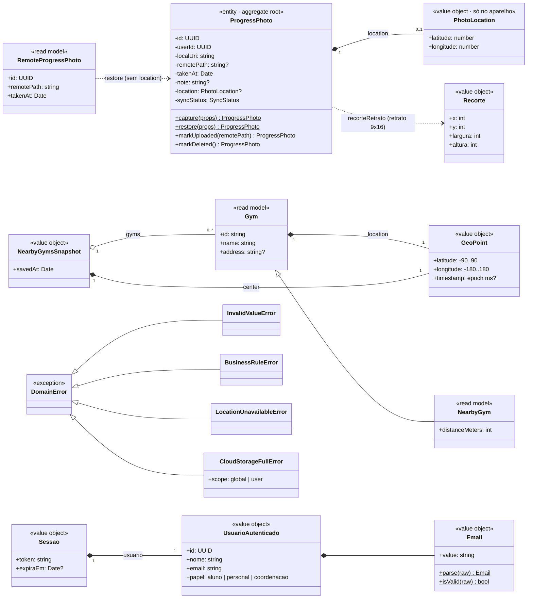
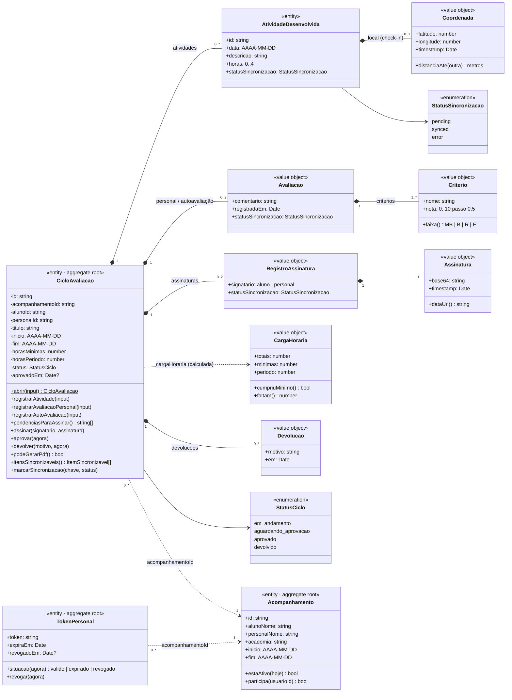
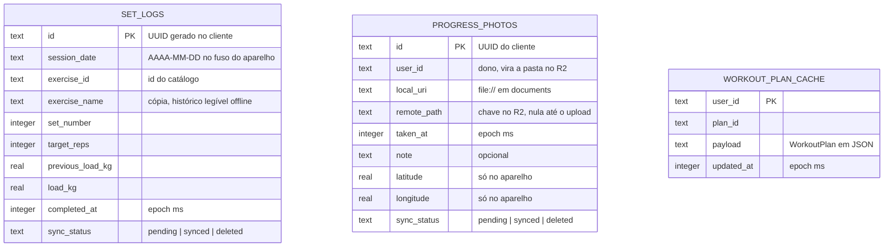
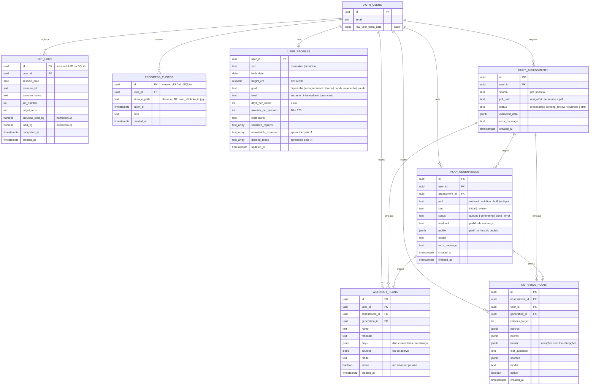

# 3 · Diagrama de Classes e Modelo de Dados

[← Casos de uso](02-casos-de-uso.md) · [Índice](README.md) · [Próximo: Objetos →](04-objetos.md)

As classes saíram dos substantivos dos casos de uso: série, carga, exercício, treino, plano, perfil, avaliação, dieta, refeição, foto, academia, localização, sessão, ciclo, critério e assinatura. Elas estão implementadas em `packages/core/src/domain`, com o mesmo nome no diagrama e no código.

## Controle de sincronização nas entidades

A skill pede quatro atributos de controle em toda entidade sincronizável. O Px GYM cobre a intenção de cada um com uma decisão própria, registrada aqui:

| Atributo da skill | No Px GYM | Por quê |
|---|---|---|
| `id` UUID do cliente | **Sim**: `SetLog.id` e `ProgressPhoto.id` vêm de `expo-crypto.randomUUID()` pelo port `IdGenerator` | Criar offline sem colisão e tornar o envio idempotente. O mesmo id da foto vira o nome do arquivo no R2. |
| `updated_at` (last-write-wins) | **Não** | Séries e fotos são **imutáveis**: corrigir uma série é desmarcar (apagar) e marcar de novo (id novo); foto não se edita, se apaga. Sem edição não há o que desempatar, e o `upsert` por id já é LWW por linha. |
| `deleted_at` (soft delete) | **Sim, como estado**: `syncStatus = "deleted"` (tombstone) em séries **e** fotos | Mesmo efeito do `deleted_at`: a linha não some antes de o servidor confirmar. Um enum evita um segundo campo para o mesmo fato. |
| `sync_status` | **Sim**: `pending · synced · deleted` | O estado `error` da skill é **transitório** no treino e nas fotos: vira o resultado `error` do caso de uso de sync e a linha continua `pending` (ver [§5](05-estados.md)). No relatório do ciclo, `error` **é persistido** (`StatusSincronizacao`), porque a fila precisa mostrar o que falhou. |

Planos, perfil e avaliações não têm controle de sync: nascem no servidor (ou são gravados direto nele) e o app só lê. A exceção é o treino ativo, que tem uma **cópia de leitura** no aparelho (`workout_plan_cache`), sem fila: ela é sobrescrita a cada leitura bem-sucedida.

## Diagrama de classes

Dividido em três recortes. As setas seguem a notação UML do Mermaid: `*--` composição, `o--` agregação, `-->` associação, `..>` referência por id, `<|--` herança.

### 3.a Treino, planos e avaliação

```mermaid
classDiagram
    direction LR

    class SetLog {
        <<entity · aggregate root>>
        -id: UUID
        -sessionDate: AAAA-MM-DD
        -exerciseId: string
        -exerciseName: string
        -setNumber: int
        -targetReps: int
        -previousLoad: Load
        -load: Load
        -completedAt: Date
        -syncStatus: SyncStatus
        +create(props)$ SetLog
        +restore(props)$ SetLog
        +deltaKg() number
        +isProgress() bool
        +markSynced() SetLog
        +markDeleted() SetLog
    }
    class Load {
        <<value object>>
        +kg: number
        +STEP_KG = 2.5$
        +fromKg(kg)$ Load
        +increment() Load
        +decrement() Load
        +deltaFrom(previous) number
    }
    class SyncStatus {
        <<enumeration>>
        pending
        synced
        deleted
    }
    class Workout {
        <<entity · read model do dia>>
        +id: string
        +label: string
        +name: string
        +focus: string
        +estimatedMinutes: int
        +progress() WorkoutProgress
        +isComplete() bool
    }
    class Exercise {
        <<entity>>
        +id: string
        +name: string
        +muscleGroup: string
        +restSeconds: int
    }
    class PlannedSet {
        <<value object>>
        +setNumber: int
        +targetReps: int
        +targetLoadKg: number
        +previousLoadKg: number
        +completed: bool
    }
    class WorkoutPlan {
        <<entity · aggregate root>>
        +id: UUID
        +userId: UUID
        +name: string
        +rationale: string
        +sources: string[]
        +assessmentId: UUID?
        +createdAt: Date
    }
    class PlanDay {
        <<value object>>
        +label: string
        +name: string
        +focus: string
        +estimatedMinutes: int
    }
    class PlanExercise {
        <<value object>>
        +exerciseId: string
        +name: string
        +muscleGroup: string
        +sets: int
        +reps: int
        +restSeconds: int
        +notes: string
    }
    class TrainingProfile {
        <<entity · aggregate root>>
        +userId: UUID
        +sex: Sexo
        +birthDate: AAAA-MM-DD
        +heightCm: number
        +goal: Objetivo
        +level: Nivel
        +daysPerWeek: 2..6
        +minutesPerSession: 20..120
        +restrictions: string
        +sensitiveRegions: RegiaoSensivel[]
        +unavailableExercises: string[]
        +dislikedFoods: string[]
    }
    class BodyAssessment {
        <<entity · aggregate root>>
        +id: UUID
        +userId: UUID
        +pdfPath: string?
        +source: pdf | manual
        +status: AssessmentStatus
        +errorMessage: string?
        +createdAt: Date
    }
    class ExtractedAssessment {
        <<value object>>
        +weightKg: number?
        +bodyFatPct: number?
        +muscleMassKg: number?
        +assessmentDate: string?
        +notes: string?
    }
    class AssessmentMeasurement {
        <<value object>>
        +label: string
        +valueCm: number
    }
    class NutritionPlan {
        <<entity · aggregate root>>
        +id: UUID
        +assessmentId: UUID
        +caloriesTarget: int
        +dietGuidance: string
        +model: string
    }
    class MacroTarget {
        <<value object>>
        +grams: number
        +rationale: string
    }
    class MicroTarget {
        <<value object>>
        +name: string
        +targetAmount: number
        +unit: string
    }
    class Meal {
        <<value object>>
        +name: string
    }
    class MealOption {
        <<value object>>
        +kcal: number
        +protein: number
        +carbs: number
        +fat: number
    }
    class MealFood {
        <<value object>>
        +name: string
        +grams: number
        +measure: string
        +protein: number
        +carbs: number
        +fat: number
    }

    SetLog "1" *-- "2" Load : load / previousLoad
    SetLog --> SyncStatus
    SetLog "0..*" ..> "1" Exercise : exerciseId (catálogo)
    Workout "1" o-- "1..*" Exercise : agrega
    Exercise "1" *-- "1..*" PlannedSet : compõe
    WorkoutPlan "1" *-- "1..*" PlanDay : days
    PlanDay "1" *-- "1..*" PlanExercise : exercises
    WorkoutPlan ..> Workout : montarTreinoDoDia
    WorkoutPlan "0..*" ..> "0..1" BodyAssessment : assessmentId
    BodyAssessment "1" *-- "0..1" ExtractedAssessment : extracted
    ExtractedAssessment "1" *-- "0..*" AssessmentMeasurement
    NutritionPlan "0..*" ..> "1" BodyAssessment : assessmentId
    NutritionPlan "1" *-- "3" MacroTarget : proteína/carbo/gordura
    NutritionPlan "1" *-- "0..*" MicroTarget
    NutritionPlan "1" *-- "0..*" Meal : meals
    Meal "1" *-- "2..3" MealOption : options
    MealOption "1" *-- "1..*" MealFood : foods
```

**Leitura das relações**

- **Composição (`*--`)**: a parte não existe sem o todo. São os casos de `PlannedSet` dentro de `Exercise`, das duas `Load` dentro de `SetLog`, dos dias e exercícios dentro do `WorkoutPlan`, das refeições, opções e alimentos dentro da dieta e da extração dentro da avaliação.
- **Agregação (`o--`)**: `Workout` agrupa `Exercise`s que existem por conta própria (o mesmo exercício do catálogo aparece em vários dias e planos).
- **Referência por id (`..>`)**: `SetLog` guarda `exerciseId` e uma cópia do nome, sem segurar o objeto `Exercise`. É isso que mantém o histórico legível offline mesmo se o plano mudar. Os planos apontam para a avaliação que os originou só pelo id. É assim que o app sabe se a avaliação mais recente é mais nova que a do plano (`avaliacaoMaisNovaQueOPlano`).
- **`WorkoutPlan` × `Workout`**: o plano é o que a IA gerou para a semana (sem cargas). O `Workout` é o **read model do dia**, montado no aparelho por `montarTreinoDoDia` a partir do plano e do histórico de séries. A meta de carga sai do histórico, não da IA.
- `TrainingProfile` não tem relação de objeto com os planos: ele é **entrada** da geração (via Edge Function). As duas listas aprendidas (`unavailableExercises`, `dislikedFoods`) só são escritas pela IA nos pedidos de mudança. A tela não as edita.

### 3.b Fotos, academias, sessão e erros

- `PhotoLocation` é estereotipado "só no aparelho": o mapper remoto não o envia, e `RestoreProgressPhotosUseCase` reconstrói a foto com `location: null`.
- `Recorte` é o resultado de `recorteRetrato(largura, altura)`, o maior retângulo 9:16 centralizado. O `CameraGatewayExpo` o aplica antes de redimensionar para 1080×1920 (`FORMATO_FOTO_PROGRESSO`).
- `CloudStorageFullError` é o 507 da `photo-storage` traduzido para o domínio. É ele que faz o sync de fotos parar de tentar na mesma rodada.
- `Usuario` não é classe do domínio: é a identidade do Supabase Auth, presente como `userId` nas entidades. O domínio vê só a `Sessao` traduzida pelo `SupabaseAuthGateway` (`paraSessao`), com o papel lido do `user_metadata` (sem papel, vale `aluno`).

### 3.c Relatório do ciclo de treino

O `CicloAvaliacao` é o único lugar que conhece as invariantes do relatório. Relatório assinado ou aprovado não aceita atividade nem avaliação nova. Só assina quem cumpriu as horas mínimas e tem as duas avaliações. Com as duas assinaturas, o ciclo vai sozinho para aprovação. Devolver apaga as assinaturas, porque o conteúdo vai mudar e a assinatura antiga não vale mais. O PDF só sai aprovado e com as assinaturas já sincronizadas. `CargaHoraria` é calculada a partir das atividades, não guardada.

`CardioSession` (corrida por GPS) e o `RecordCardioSessionUseCase` existem no core, mas **nenhuma tela os usa**. Ficaram fora dos diagramas e estão listados como dívida na [§10](10-implementacao.md#lacunas-e-próximos-passos).

## Persistência local × remota

| Classe | Local (SQLite, Drizzle) | Remota (Supabase / R2) | Estratégia |
|---|---|---|---|
| `SetLog` | Sim, tabela `set_logs` | Sim, tabela `set_logs` | Local é a fonte da verdade até o sync; depois, espelho. Escrita só pelo mobile (mão única), então o servidor nunca tem versão mais nova para disputar. |
| `ProgressPhoto` | Sim: arquivo em `documents/progress-photos/` e tabela `progress_photos` (com latitude e longitude) | Sim: objeto `<user_id>/<photo_id>.jpg` no **Cloudflare R2** e linha em `progress_photos` (sem local) | O binário sobe separado dos metadados, por URL assinada. A galeria **sempre** lê o arquivo local. A nuvem é backup e volta pela restauração. |
| `WorkoutPlan` | Cópia de leitura: `workout_plan_cache` (uma linha por pessoa, plano em JSON) | Sim: `workout_plans` (um ativo por pessoa) | Gerado no servidor; a cópia é sobrescrita a cada leitura online e usada quando não há rede (RF30). |
| `Workout` / `Exercise` | Não: montado em memória a cada render | Não | Read model derivado do plano e do histórico de séries. O catálogo de exercícios vive na Edge Function (`_shared/plano/exercicios.ts`, 58 exercícios), e o guia de execução no app. |
| `TrainingProfile` | Não | Sim: `user_profiles` | Lido e gravado direto no Supabase pela tela de perfil. As listas aprendidas são escritas pela Edge Function. |
| `BodyAssessment` | Não | Sim: `body_assessments` e PDF no bucket `assessments` | Gravada pelo app (`createManual`) depois de conferida, e lida sob demanda (refetch no foco). |
| `NutritionPlan` | Não | Sim: `nutrition_plans` (a ativa mais recente vale) | Gerada no servidor; lida sob demanda. |
| Pedido de geração | Não (o id da fila fica em memória) | Sim: `plan_generations` | Só o servidor escreve. É a fila (`queued`) e a base dos limites. |
| `Gym` / `NearbyGym` | Última busca no **AsyncStorage** (`NearbyGymsSnapshot`) | Não (Overpass e Nominatim em tempo real) | A posição da busca não sai do aparelho (RNF04). |
| `Sessao` | Sim: a sessão do Supabase cifrada (LargeSecureStore) e a `Sessao` do domínio no SecureStore, com uma chave por modo (real ou mock) | Sim: `auth.users` | Fonte da verdade: Supabase Auth. O cache local permite abrir o app offline. |
| `CicloAvaliacao`, `Acompanhamento`, `TokenPersonal` | **Em memória** (`Map`), com dados de demonstração | **Não** | Fase "domínio e interface primeiro": regras e telas prontas, persistência pendente. A fila (`StatusSincronizacao`) já está modelada no agregado. |
| Fila de sync (treino e fotos) | **Coluna** `sync_status` nas próprias tabelas | Não | Sem tabela `sync_queue` separada (desvio da skill): o registro é ao mesmo tempo o dado e o item da fila, então as duas coisas nunca divergem. |

## 3.1 Diagramas Entidade-Relacionamento (DER)

Regra de conversão aplicada: composição 1-N vira FK no lado "muitos" quando a parte é consultada sozinha. Quando o app só lê o todo de uma vez, vira `jsonb`: os dias do treino (`days`), as refeições (`meals`), macros, micros e a extração da avaliação (`extracted_data`). Value objects simples viram colunas embutidas (`Load` → `load_kg`/`previous_load_kg`; `PhotoLocation` → `latitude`/`longitude`).

### Schema local — SQLite (`pxgym.db`, Drizzle, `apps/mobile/src/db/schema.ts`)

Índices: `set_logs(session_date)`, `set_logs(exercise_id, completed_at)`, `set_logs(sync_status)`, `progress_photos(user_id, taken_at)` e `progress_photos(sync_status)`, um por consulta real da interface. As migrations ficam em `apps/mobile/drizzle/` (`0000` séries, `0001` fotos, `0002` local da foto, `0003` cópia do treino) e são aplicadas no boot por `useMigrations`, antes de qualquer tela tocar o banco. No modo mock, o banco nem é aberto.

As tabelas locais não têm relação entre si nem com `auth.users`: o app só guarda dados de quem está logado. A `set_logs` local não tem `user_id`; o gateway de sync o acrescenta no envio (`toSetLogRow(log, userId)`).

### Schema remoto — Supabase / Postgres (`supabase/migrations/`)

Fora do diagrama, por não terem relação com as outras tabelas, ficam as duas tabelas de **controle de custo das fotos** (migration `0005`). `photo_storage_reservations` (`photo_id` PK, `user_id`, `size_bytes`, `created_at`) guarda uma reserva por objeto no R2 e não tem FK de propósito: se a conta for apagada, o objeto continua no R2 e a reserva precisa continuar contando. `admin_alerts` (`kind` PK, `last_sent_at`) garante no máximo um aviso de cada tipo por dia.

**Funções no banco** (todas `service_role` apenas, revogadas de `anon` e `authenticated`):

| Função | Migration | O que faz, tudo ou nada |
|---|---|---|
| `complete_workout_generation` | 0006 | Desativa o treino anterior, grava o novo e fecha o pedido como `done`. |
| `complete_nutrition_generation` | 0006 → 0008 | Mesmo roteiro para a dieta; desde a 0008 grava as `meals`. |
| `complete_plan_generation` | 0004 → 0006 | Versão antiga (treino e dieta juntos), mantida para os pedidos `both`. |
| `reserve_photo_storage` | 0005 | Com *advisory lock*, soma as reservas e recusa (`user_quota` ou `global_quota`) se passar do teto; reenviar a mesma foto troca o tamanho em vez de somar. |
| `claim_admin_alert` | 0005 | Devolve `true` e marca o envio se o último aviso daquele tipo tem mais de um intervalo. |

**Histórico das migrations remotas:** `0001` avaliações, planos e bucket `assessments`; `0002` séries; `0003` fotos (e o bucket `progress-photos` do Storage, que deixou de ser usado com a ida para o R2); `0004` perfil, pedidos, treino e fontes; `0005` trava de custo das fotos; `0006` treino e dieta separados e dieta "ativa"; `0007` avaliação digitada (`source`, `pdf_path` opcional); `0008` refeições da dieta.

### Conferência local × remoto

| Campo de negócio | SQLite | Postgres | Observação |
|---|---|---|---|
| `set_logs.id` / `progress_photos.id` | `text` | `uuid` | Mesmo valor dos dois lados, e é isso que torna o `upsert` idempotente. |
| `session_date` | `text` | `date` | Formato `AAAA-MM-DD` compatível. |
| cargas | `real` | `numeric(6,2)` | `Load` arredonda a 2 casas e limita a 1000 kg, dentro de `numeric(6,2)`. |
| `completed_at` / `taken_at` | `integer` (ms) | `timestamptz` | Convertidos pelo mapper (`toISOString()`). |
| `sync_status` | coluna | — | Só existe localmente (controle de fila). |
| `local_uri` | coluna | — | Caminho do aparelho; não faz sentido no servidor. |
| `latitude` / `longitude` da foto | colunas | — | Privacidade: não sobem (RNF04). |
| `remote_path` / `storage_path` | `remote_path` | `storage_path` | Mesmo valor: a chave `<user_id>/<photo_id>.jpg` no R2. |
| `user_id` | só em fotos e no cache do treino | todas as tabelas | Séries locais pertencem implicitamente a quem está logado. |
| `workout_plan_cache.payload` | `text` (JSON) | linha de `workout_plans` | O mapper `toWorkoutPlan` gera o objeto; o cache guarda o objeto inteiro, `assessmentId` incluído. |
| `created_at` | — | default `now()` | Auditoria do servidor. |

As cardinalidades batem com o diagrama de classes: um usuário tem 0..N séries, fotos, avaliações e planos, 0..1 perfil e no máximo **um** treino ativo (índice único parcial `workout_plans_one_active_idx`). Uma avaliação origina 0..N pedidos e planos.

### Row Level Security (RLS)

Toda tabela remota tem RLS ligada. O app usa só a chave anônima, e é a RLS que decide o que cada sessão vê. As Edge Functions usam dois clientes: o **do usuário** (com o JWT dele, sujeito à RLS) para ler o que é dele, e o **admin** (`service_role`) só para o que o usuário não pode escrever.

| Tabela / bucket | select | insert | update | delete | Regra |
|---|---|---|---|---|---|
| `set_logs` | ✔ | ✔ | ✔ | ✔ | `auth.uid() = user_id` |
| `progress_photos` | ✔ | ✔ | ✔ | ✔ | `auth.uid() = user_id` |
| `body_assessments` | ✔ | ✔ | ✔ | ✔ | `auth.uid() = user_id` |
| `nutrition_plans` | ✔ | ✔ | — | ✔ | `auth.uid() = user_id` (plano não é editado) |
| `user_profiles` | ✔ | ✔ | ✔ | — | `auth.uid() = user_id` |
| `plan_generations` | ✔ | — | — | — | Só leitura do dono; escrita só pela `generate-plan` |
| `workout_plans` | ✔ | — | — | — | Só leitura do dono; escrita só pela RPC |
| `photo_storage_reservations`, `admin_alerts` | — | — | — | — | RLS ligada **sem** políticas: só a `service_role` alcança |
| storage `assessments` | ✔ | ✔ | — | ✔ | `(storage.foldername(name))[1] = auth.uid()::text` |
| R2 `px-gym-fotos` | — | — | — | — | Bucket privado; o acesso só existe por URL assinada (5 min) que a `photo-storage` emite para a pasta do próprio JWT |

Além da RLS, o gateway de sync filtra o `delete` de séries por `user_id` (defesa em profundidade, coberta por teste em `packages/db`). A `extract-assessment` recusa caminho de PDF fora da pasta do usuário ou com `..`.
