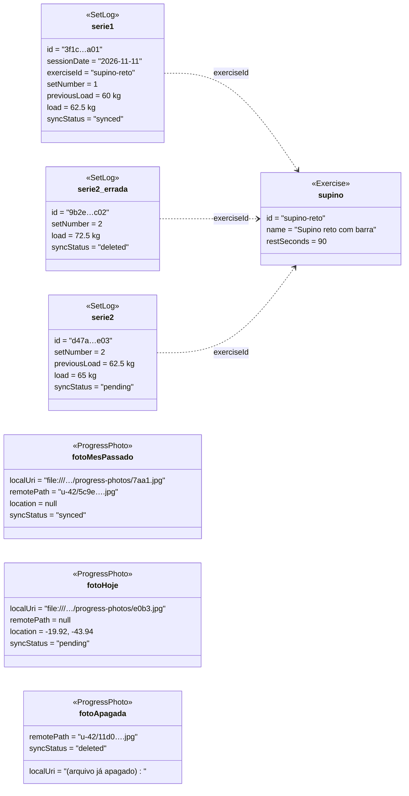
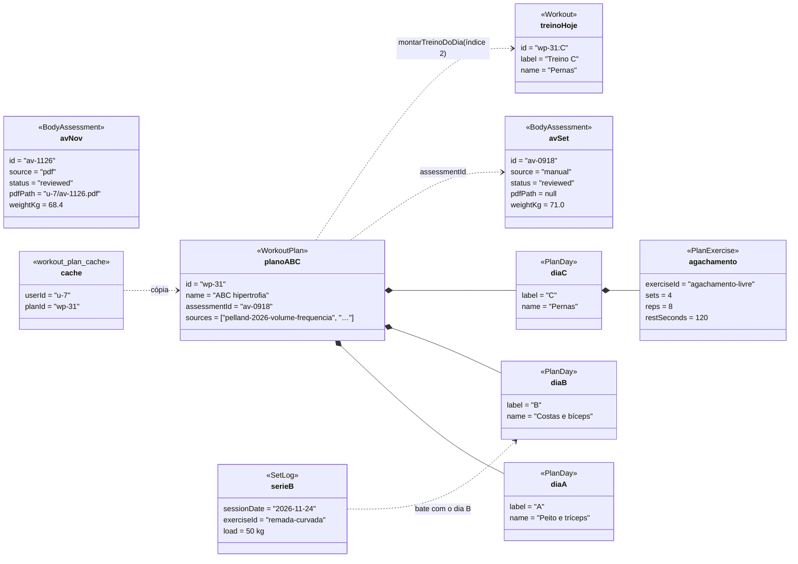

# 4 · Diagramas de Objetos

[← Classes e dados](03-classes-e-dados.md) · [Índice](README.md) · [Próximo: Estados →](05-estados.md)

Dois instantâneos do diagrama de classes, com valores reais, escolhidos para validar os cenários mais delicados do app. O primeiro é o do offline-first: **o mesmo dia de treino com registros em três estados de sincronização** e uma galeria parcialmente enviada, com uma foto apagada esperando a nuvem. O segundo é o dos planos gerados por IA: **uma avaliação nova chegando depois do treino** e o treino do dia sendo montado a partir do plano e do histórico.

## 4.1 Um dia de treino com a rede caindo

**Cenário.** Praticante no supino, terça 11/11/2026, com o Wi-Fi da academia caindo:

1. Série 1 marcada às 19:00, com rede: subiu (`synced`).
2. Série 2 marcada às 19:03: também subiu, mas o praticante viu que marcou errado e desmarcou às 19:04, já sem rede. Virou tombstone (`deleted`).
3. Série 2 remarcada às 19:05 com a carga certa, ainda sem rede: `pending` (id novo).
4. A foto do mês passado já está no R2. A de hoje ainda não subiu. Uma foto antiga foi apagada sem rede: o arquivo local já saiu, mas a cópia do R2 ainda precisa ser removida.

### O que o instantâneo valida

| Pergunta | Resposta no modelo | Onde está garantido |
|---|---|---|
| A tela do exercício mostra quantas séries? | **2** (`serie1` e `serie2`). O tombstone é invisível para leituras. | `bySessionDate` exclui `deleted`; teste *"tombstone some das leituras mas continua visível pro sync"* (`apps/mobile/src/db/__tests__/set-log-repository.test.ts`). |
| Qual é a "carga anterior" da `serie2`? | **62,5 kg** (a da `serie1`), e **não** os 72,5 kg da série apagada. | `lastLoadKgForExercise` ignora tombstones; mesmo teste. |
| O que a próxima sincronização faz com as séries? | `upsert` de `serie2`, depois `delete` remoto de `serie2_errada` e só então a remoção local. | `SyncPendingSetLogsUseCase` (ordem pendentes → exclusões); testes em `packages/core/src/application/__tests__/sync.test.ts`. |
| E se o `delete` falhar depois do `upsert` dar certo? | Resultado `error` com `synced: 1`; `serie2` fica `synced`, e o tombstone continua esperando. | Teste *"push ok + delete falhando: conta o que subiu e segura o tombstone"*. |
| E com as fotos? | Primeiro apaga `fotoApagada` no R2 (libera espaço) e só então a linha; depois envia `fotoHoje`. | `SyncPendingPhotosUseCase`; teste *"apagar libera espaço antes dos envios na mesma rodada"* (`photo-lifecycle.test.ts`). |
| A restauração traz `fotoApagada` de volta? | **Não**. O id dela continua em `knownIds` enquanto ela é tombstone. | Teste *"não ressuscita foto apagada que ainda espera remoção na nuvem"*. |
| A posição de `fotoHoje` sobe? | **Não**. Fica só no SQLite; `fotoMesPassado`, que veio de uma restauração, nem tem posição. | `SupabaseProgressPhotoStore.saveRow` não envia local; teste *"baixa só o que falta no aparelho, já como synced e sem posição"*. |
| Configurações mostra o quê? | "Séries aguardando envio: 1 · Remoções aguardando envio: 1 · Fotos aguardando upload: 1". | `usePendingSync` (`apps/mobile/src/lib/use-local-data.ts`). |
| A galeria mostra quais fotos offline? | `fotoMesPassado` (ponto volt) e `fotoHoje` (ponto âmbar). `fotoApagada` já sumiu. | A galeria lê o arquivo local, nunca a URL remota; `listByUser` exclui tombstones. |

## 4.2 Avaliação nova depois do treino

**Cenário.** Em setembro, a praticante registrou a avaliação `avSet` (digitada) e gerou o treino `planoABC`, de três dias. Na última semana treinou o dia B. Hoje (26/11) enviou o PDF de uma bioimpedância nova; a IA leu, ela conferiu e salvou `avNov`. Ela abre a aba Treino sem ter treinado hoje.

### O que o instantâneo valida

| Pergunta | Resposta no modelo | Onde está garantido |
|---|---|---|
| Qual dia é o de hoje? | **C**: a última sessão (24/11) bate com o dia B, então hoje é o seguinte. Se ela já tivesse treinado hoje, continuaria no dia de hoje. | `indiceDoTreinoDeHoje`; testes *"depois do treino B, hoje é o C"* e *"se já treinou hoje, continua no treino de hoje"* (`treino-do-dia.test.ts`). |
| Qual a meta de carga do agachamento? | A maior carga da **última sessão** em que ele foi feito; se nunca foi feito, **0 kg**, e ela sobe no stepper. | `montarTreinoDoDia`; teste *"exercício nunca feito começa com carga zero"*. |
| A tela mostra o aviso de avaliação nova? | **Sim**: o plano usa `av-0918` e a revisada mais recente é `av-1126`. | `avaliacaoMaisNovaQueOPlano`; teste *"sugere a avaliação nova quando o plano foi feito com outra"* (`avaliacao-nova.test.ts`). |
| E se o plano fosse de uma versão antiga, sem `assessmentId`? | **Não** mostra o aviso, para não insistir à toa. | Teste *"não sugere quando não se sabe de qual avaliação o plano veio"*. |
| Ela toca "Atualizar meu treino". De qual avaliação sai o novo? | Da revisada mais recente, `av-1126`. O novo plano passa a ser o único ativo e substitui a cópia do aparelho. | `GenerateWorkoutPlanUseCase.generate`; teste *"gera a partir da avaliação revisada mais recente e guarda o treino no aparelho"* (`workout-plan.test.ts`). |
| E se ela abrir o app no subsolo, sem rede? | O treino abre da `cache` (`wp-31`); o aviso de avaliação nova não aparece, porque ele depende da leitura remota. | `LoadActiveWorkoutPlanUseCase`; teste *"sem internet, usa o treino guardado no aparelho"*. |
| Uma mudança pedida ("sem leg press") muda a avaliação de origem? | Não: o plano mudado continua preso à avaliação do plano que mudou. | Edge Function `generate-plan` (revisão usa o `assessment_id` do treino ativo) e `useWorkoutGeneration` (`mesmaAvaliacao`). |

Os dois cenários são a massa de dados dos testes citados: o diagrama de objetos virou teste (seção 10).
