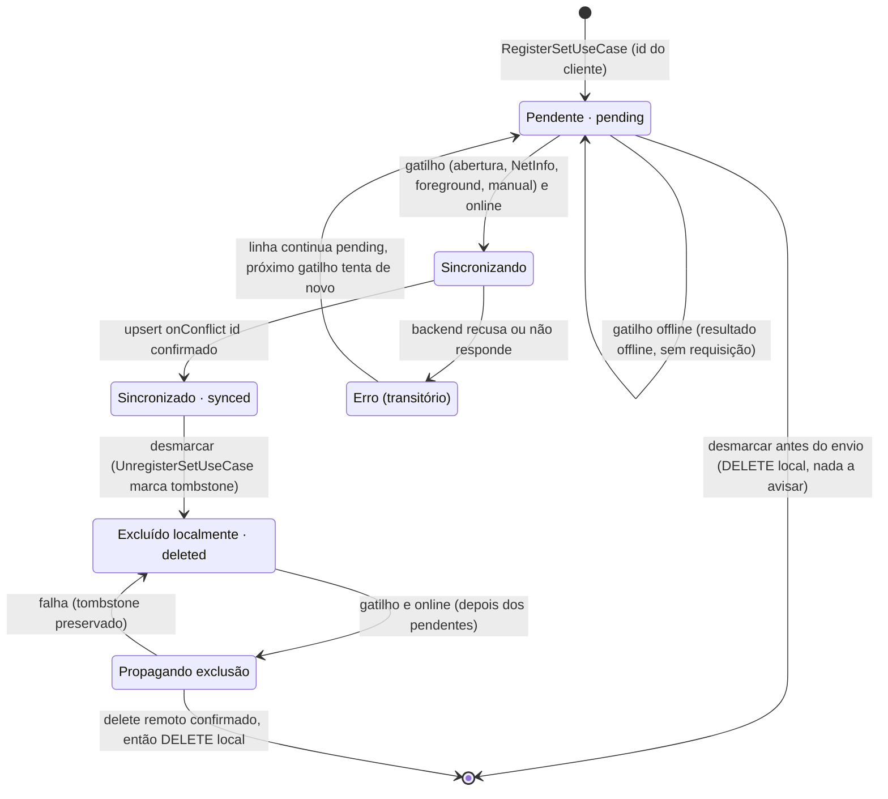
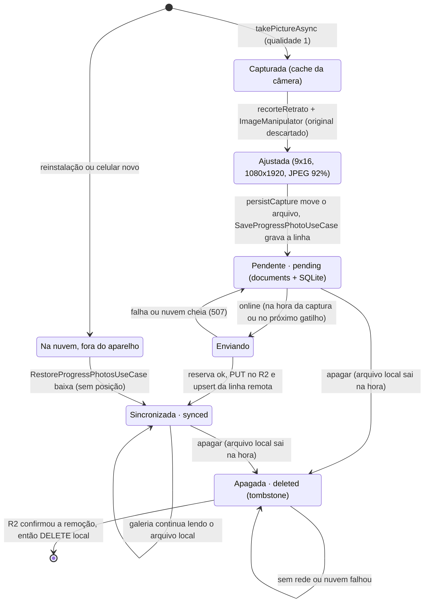
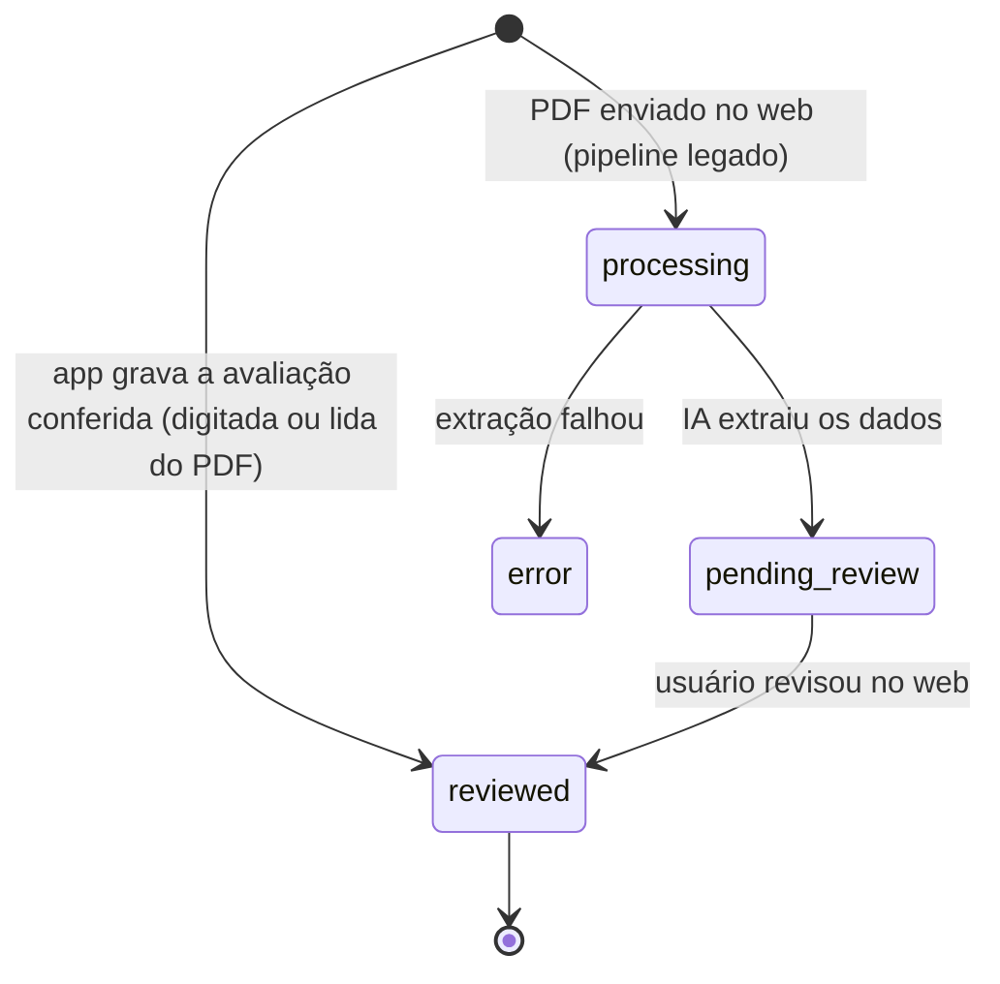
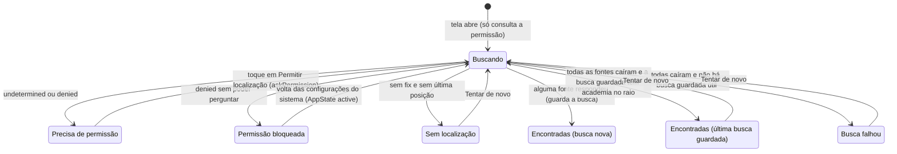
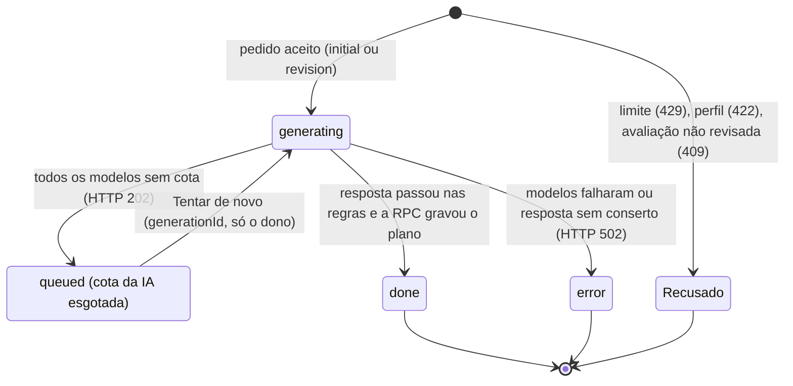
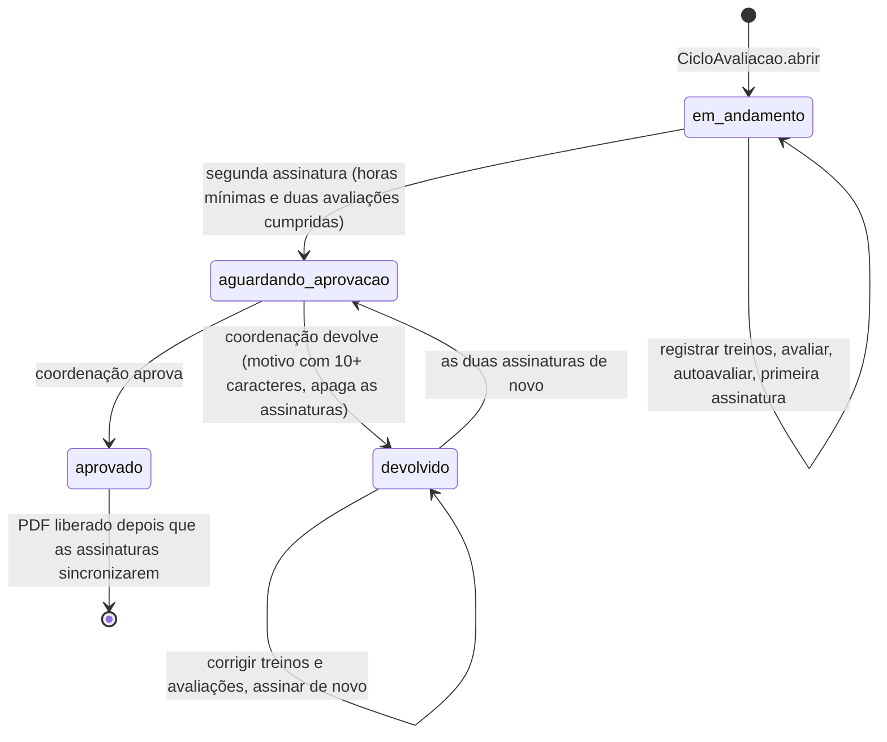

# 5 · Diagramas de Estados

[← Objetos](04-objetos.md) · [Índice](README.md) · [Próximo: Fronteira, controle e entidade →](06-fronteira-controle-entidade.md)

O Px GYM tem dois ciclos de **sincronização** (série e foto) e três ciclos de **negócio** independentes: a avaliação física, o pedido de geração de plano e o relatório do ciclo de treino. Tem também a máquina de estados da **busca de academias**, que organiza a tela com mais caminhos alternativos. Como pede a skill, os ciclos de sync e os de negócio ficam em diagramas separados.

## 5.1 Ciclo de sincronização de `SetLog`

Persistidos: `pending`, `synced`, `deleted` (coluna `sync_status`). **Transitórios**, que existem só durante a execução do caso de uso: *Sincronizando*, *Erro*, *PropagandoExclusão*.

Regras que o diagrama impõe e onde estão no código:

- **Não existe `Sincronizado → Pendente`.** A skill prevê "nova edição local", mas aqui o `SetLog` é imutável: corrigir carga é desmarcar e marcar de novo, o que gera um id novo. Isso elimina conflito de edição.
- A troca de estado nunca é "solta": só acontece por `SetLog.markSynced()` / `markDeleted()` (entidade) e pelos casos de uso `RegisterSet`, `UnregisterSet` e `SyncPendingSetLogs`.
- *Erro* não é persistido de propósito. Como a sincronização só roda em gatilhos (sem laço), não há risco de martelar o servidor, e a linha `pending` já faz o papel de "retry". A consequência é que um registro que o servidor sempre rejeita bloqueia o lote inteiro; isso está nas [lacunas](10-implementacao.md#lacunas-e-próximos-passos).

## 5.2 Ciclo de vida de `ProgressPhoto`

- O passo *Cache → Pendente* é o que torna a foto durável: o cache pode ser limpo pelo sistema a qualquer momento, e `documents/` não.
- **Até foto `pending` vira tombstone** ao ser apagada. O upload pode ter chegado ao servidor sem a confirmação voltar, e aí a restauração a traria de volta. O tombstone mantém o id em `knownIds`, e a restauração não o toca.
- **Nuvem cheia não é erro para a pessoa.** O 507 da `photo-storage` vira `CloudStorageFullError`: a rodada para de enviar (as próximas também seriam recusadas), a foto fica `pending` e só o administrador é avisado.

## 5.3 Ciclo de negócio de `BodyAssessment`

No app, a avaliação **nasce revisada**. A pessoa conferiu cada número no formulário, tanto quando digitou quanto quando a IA leu o PDF. Por isso o fluxo do app não passa por `processing` nem `pending_review`: a leitura do PDF (`extract-assessment`) só devolve números, sem gravar nada. Os outros estados continuam no modelo porque o web ainda os produz e a lista de avaliações os mostra. A regra "só gera plano de avaliação revisada" mora em três lugares, por defesa em profundidade: `GenerateWorkoutPlanUseCase`/`GenerateDietPlanUseCase` (usam `latestReviewed`), a Edge Function `generate-plan` (409 se não estiver revisada) e o antigo `GenerateNutritionPlanUseCase`.

## 5.4 Estados da busca de academias

Os estados são exatamente os resultados do `FindNearbyGymsUseCase`; a tela só os desenha.

*Encontradas (última busca guardada)* mostra a data da busca (`cachedAt`), com as distâncias recalculadas para a posição **atual**. Se a pessoa saiu de perto e nenhuma academia guardada fica no raio, o estado é *Busca falhou*, e não "nenhuma academia", porque essa resposta seria falsa.

## 5.5 Pedido de geração de plano (`plan_generations`)

Cada toque em "Gerar", "Pedir mudança" ou "Tentar de novo" é um pedido. A tabela é ao mesmo tempo a **fila** (pedidos `queued`) e a **base dos limites** (os pedidos `done` contam por avaliação, os que não são `error` contam por dia). Só o servidor escreve nela.

- *Recusado* não chega a virar linha: a recusa acontece antes do `insert`. Os mesmos pré-requisitos são conferidos antes no aparelho, para nem gastar a viagem.
- Ao entrar em *Feito*, a RPC desativa o plano anterior da mesma parte na mesma transação. Por isso nunca existem dois treinos ativos, nem um instante sem nenhum.
- Os pedidos antigos `part = both`, de quando treino e dieta saíam juntos, não são retomados por esta versão.

## 5.6 Ciclo de negócio do relatório (`StatusCiclo`)

`editavel` é verdadeiro só em `em_andamento` e `devolvido` **e enquanto ninguém assinou**: a primeira assinatura trava o conteúdo, e só a devolução (que apaga as assinaturas) o destrava. Fora disso, registrar treino ou avaliação lança `BusinessRuleError`. Cada item do relatório (treino, avaliação, assinatura) tem também o próprio `StatusSincronizacao` (`pending → synced`, ou `error` → volta para a fila na próxima rodada). Diferente das séries, aqui o `error` **é persistido**, porque a tela do relatório mostra o que falhou e o `SincronizacaoService` prioriza o que espera há mais tempo.
