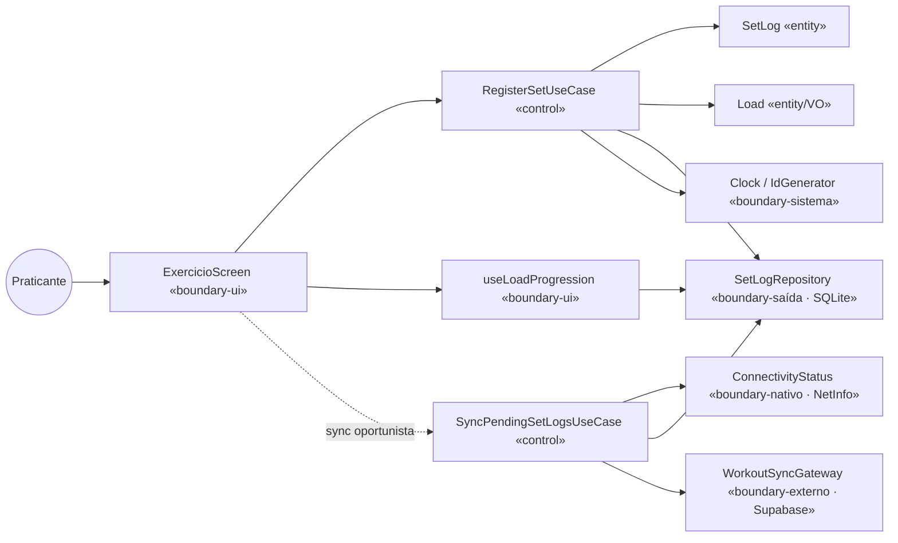
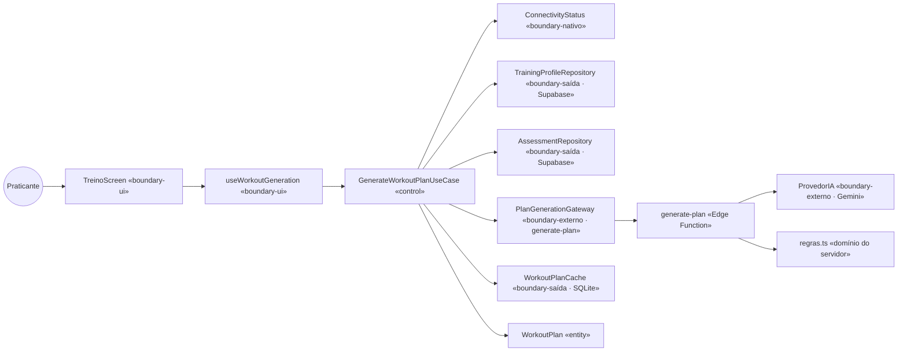
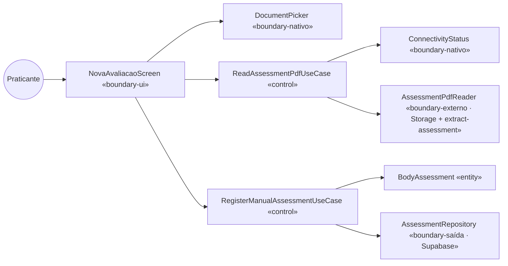
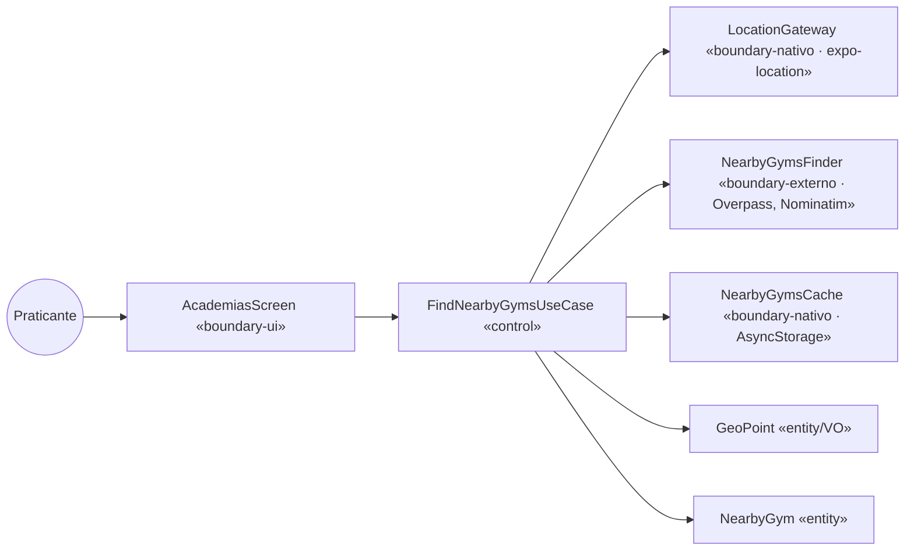
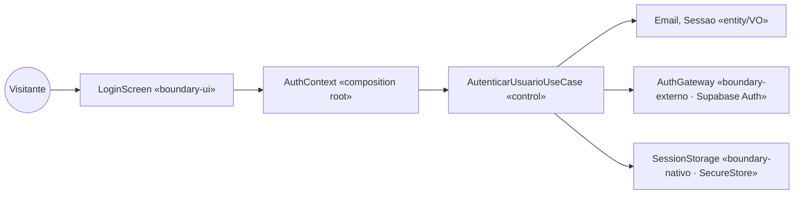

# 6 · Classes de Fronteira, Controle e Entidade

[← Estados](05-estados.md) · [Índice](README.md) · [Próximo: Sequência →](07-sequencia.md)

Esta reclassificação vira, na [§10](10-implementacao.md), as camadas da Clean Architecture. Num app mobile a fronteira tem dois lados: a **UI** (telas Expo Router) e os **recursos nativos e externos** (GPS, câmera, seletor de arquivo, rede, Supabase, Edge Functions, R2, OpenStreetMap). Os dois são ponto de contato com algo fora do domínio.

| Estereótipo | No Px GYM | Onde mora |
|---|---|---|
| **«boundary-ui»** | Telas `…Screen` e hooks de leitura (`useTodayWorkout`, `useLoadProgression`, `usePendingSync`, `useProgressPhotos`, `useAssessments`, `useLatestPlan`, `useRelatorio`…) | `apps/mobile/src/app`, `apps/mobile/src/adapters/screens`, `apps/mobile/src/lib/use-*.ts`, `apps/mobile/src/adapters/hooks` |
| **«boundary-nativo»** | Port no domínio e implementação no adapter: `LocationGateway`/`LocationGatewayExpo`, `CameraGateway`/`CameraGatewayExpo`, `ConnectivityStatus`/`netInfoConnectivity`, `SessionStorage`/`SessionStorageSecureStore`, `NearbyGymsCache`/`NearbyGymsCacheAsyncStorage`, `LocalPhotoFiles` (expo-file-system) | ports em `packages/core/src/domain/contracts`; adapters em `apps/mobile/src/adapters/gateways`, `adapters/auth` e `lib` |
| **«boundary-externo»** | `AuthGateway`/`SupabaseAuthGateway`, `WorkoutSyncGateway`/`SupabaseWorkoutSyncGateway`, `ProgressPhotoUploader` + `ProgressPhotoCloud`/`R2ProgressPhotoCloud`, `PlanGenerationGateway`/`SupabasePlanGenerationGateway`, `AssessmentPdfReader`/`SupabaseAssessmentPdfReader`, `NearbyGymsFinder`/`FirstAvailableGymFinder` (Overpass e Nominatim) | adapters em `packages/db/src` e `apps/mobile/src/adapters/gateways` |
| **«boundary-saída» (persistência)** | `SetLogRepository`/`DrizzleSetLogRepository`, `ProgressPhotoRepository`/`DrizzleProgressPhotoRepository`, `WorkoutPlanCache`/`DrizzleWorkoutPlanCache`, `AssessmentRepository`/`SupabaseAssessmentRepository`, `NutritionPlanRepository`/`SupabaseNutritionPlanRepository`, `TrainingProfileRepository`/`SupabaseTrainingProfileRepository`, `ActiveWorkoutPlanSource`/`SupabaseWorkoutPlanRepository`, `CicloAvaliacaoRepository`/`…Memoria` | ports no core; adapters em `apps/mobile/src/db`, `packages/db/src/repositories` e `apps/mobile/src/adapters/memoria` |
| **«control»** | `…UseCase`: orquestra, não guarda estado e conhece só ports. Os serviços de domínio puros (`indiceDoTreinoDeHoje`, `montarTreinoDoDia`, `avaliacaoMaisNovaQueOPlano`, `recorteRetrato`…) são chamados por controls ou por hooks. | `packages/core/src/application/use-cases`, `packages/core/src/domain/services` |
| **«entity»** | Classes da [§3](03-classes-e-dados.md) | `packages/core/src/domain/entities`, `value-objects` |

Regra: 1 boundary de UI por tela; 1 gateway por recurso externo; 1 control por caso de uso. Nenhum control importa `expo-*`, `drizzle-orm` ou `@supabase/supabase-js`; isso foi verificado, e `packages/core` não importa nenhum pacote externo.

Do outro lado da rede há uma segunda fronteira, a das **Edge Functions**, com a mesma divisão em pequeno. O `index.ts` de cada função é o boundary HTTP (valida o corpo com Zod, lê o JWT, aplica os limites). `gerarTreino`, `gerarDieta` e `extrairAvaliacao` são os controls. `ProvedorIA`/`gemini.ts` é o gateway da IA. `regras.ts` é o domínio do servidor (catálogo, vetos, fórmula).

## Diagramas de robustez

### UC07 Registrar série

### UC26 Gerar treino com IA

### UC24 + UC25 Registrar avaliação pelo PDF

### UC17 Encontrar academias por perto

### UC01 Entrar

## Tabela de mapeamento por caso de uso

| Caso de uso | Boundary (UI) | Boundary (nativo / externo / saída) | Control | Entities |
|---|---|---|---|---|
| UC01 Entrar | `LoginScreen` | `AuthGateway` → `SupabaseAuthGateway`, `SessionStorage` | `AutenticarUsuarioUseCase`, `RestaurarSessaoUseCase` | `Email`, `Sessao` |
| UC02 Criar conta | `CadastroScreen` | `AuthGateway` | `SignUpUseCase` | `Email` |
| UC03 Sair da conta | `ConfiguracoesScreen`, `PerfilScreen` | `AuthGateway.signOut`, `SessionStorage.limpar` | `EncerrarSessaoUseCase` | `Sessao` |
| UC04 Ver painel do dia | `Inicio` + `useStreakDays`, `useWeekActivity`, `useTodayWorkout`, `useBodyMetrics`, `useLatestPlan` | `SetLogRepository`, `WorkoutPlanCache`, `AssessmentRepository`, `NutritionPlanRepository` | `computeStreakDays`, `computeWeekActivity`, `buildBodyHistory` | `SetLog`, `Workout`, `BodyAssessment`, `NutritionPlan` |
| UC05 Executar treino do dia | `TreinoScreen` + `useTodayWorkout`, `useTodayDoneByExercise` | `ActiveWorkoutPlanSource`, `WorkoutPlanCache`, `SetLogRepository` | `LoadActiveWorkoutPlanUseCase`, `indiceDoTreinoDeHoje`, `montarTreinoDoDia` | `WorkoutPlan`, `Workout`, `Exercise`, `SetLog` |
| UC06 Abrir exercício por QR | `ScannerScreen` | `CameraView` (componente de UI) | `parseExerciseId` (na tela), `useWorkoutWithExercise` | `Exercise` |
| UC07 Registrar série | `ExercicioScreen` | `SetLogRepository`, `Clock`, `IdGenerator` | `RegisterSetUseCase` | `SetLog`, `Load` |
| UC08 Calcular progressão | `LoadProgressionCard` + `useLoadProgression` | `SetLogRepository` | `computeLoadProgression` | `SetLog` |
| UC10 Desmarcar série | `ExercicioScreen` | `SetLogRepository` | `UnregisterSetUseCase` | `SetLog` |
| UC11/UC12 Registrar foto | `CameraScreen` | `CameraGateway` → `CameraGatewayExpo`, `persistCapture`, `ProgressPhotoRepository`, `ProgressPhotoUploader`, `LocationGateway`, `ConnectivityStatus` | `SaveProgressPhotoUseCase`, `recorteRetrato` | `ProgressPhoto`, `PhotoLocation` |
| UC13/UC32 Galeria e tela cheia | `FotosScreen` + `useProgressPhotos`, `PhotoViewer` | `ProgressPhotoRepository` (SQLite) | — (leitura) | `ProgressPhoto` |
| UC33 Apagar foto | `FotosScreen`, `PhotoViewer` | `ProgressPhotoRepository`, `ProgressPhotoCloud`, `LocalPhotoFiles`, `ConnectivityStatus` | `DeleteProgressPhotoUseCase` | `ProgressPhoto` |
| UC14 Composição corporal | `ProgressoScreen` + `useAssessments` | `AssessmentRepository` | `buildBodyHistory`, `historyDelta`, `diffMeasurements` | `BodyAssessment` |
| UC15 Avaliações | `AvaliacoesScreen` + `useAssessments` | `AssessmentRepository` | — (leitura) | `BodyAssessment` |
| UC16 Dieta e cardápio | `NutricaoScreen` + `useLatestPlan`, `WeeklyMenu` | `NutritionPlanRepository` | `cardapioDoDia`, `opcaoDoDia` (lib de apresentação) | `NutritionPlan`, `Meal` |
| UC17/UC18 Academias | `AcademiasScreen` | `LocationGateway`, `NearbyGymsFinder` → `FirstAvailableGymFinder`, `NearbyGymsCache` | `FindNearbyGymsUseCase` | `GeoPoint`, `Gym`, `NearbyGym` |
| UC19 Sincronizar agora | `ConfiguracoesScreen` + `usePendingSync` | como UC20 | como UC20 | como UC20 |
| UC20–UC22, UC34 Sincronizar | nenhuma: hook `useWorkoutSync` no layout da área logada | `WorkoutSyncGateway`, `ProgressPhotoUploader`, `ProgressPhotoCloud`, `ConnectivityStatus` | `SyncPendingSetLogsUseCase`, `SyncPendingPhotosUseCase`, `RestoreProgressPhotosUseCase` | `SetLog`, `ProgressPhoto` |
| UC23 Perfil de treino | `PerfilTreinoScreen` | `TrainingProfileRepository` | `SaveTrainingProfileUseCase` | `TrainingProfile` |
| UC24 Registrar avaliação | `NovaAvaliacaoScreen` | `AssessmentRepository`, `Clock`, `IdGenerator` | `RegisterManualAssessmentUseCase` | `BodyAssessment` |
| UC25 Ler PDF | `NovaAvaliacaoScreen` | `DocumentPicker`, `AssessmentPdfReader`, `ConnectivityStatus` | `ReadAssessmentPdfUseCase` | `ExtractedAssessment` |
| UC26/UC28/UC29 Treino com IA | `TreinoScreen` + `useWorkoutGeneration` | `PlanGenerationGateway`, `TrainingProfileRepository`, `AssessmentRepository`, `WorkoutPlanCache`, `ConnectivityStatus` | `GenerateWorkoutPlanUseCase` | `WorkoutPlan` |
| UC27/UC28/UC29 Dieta com IA | `NutricaoScreen` + `useDietGeneration` | `PlanGenerationGateway`, `TrainingProfileRepository`, `AssessmentRepository`, `ConnectivityStatus` | `GenerateDietPlanUseCase` | `NutritionPlan` |
| UC30 Avaliação nova | `NewAssessmentCard` + `useLatestReviewedAssessment` | `AssessmentRepository` | `avaliacaoMaisNovaQueOPlano` | `BodyAssessment`, `WorkoutPlan`, `NutritionPlan` |
| UC31 Guia de execução | `ExerciseGuideCard` | — (dados estáticos, CC0) | `guiaDoExercicio`, `linkDoVideo` | — |
| UC35 Registrar treinos do ciclo | `AtividadesFormScreen` + `useAtividades` | `CicloAvaliacaoRepository`, `LocationGateway`, `IdGenerator` | `RegistrarAtividadesUseCase` | `CicloAvaliacao`, `AtividadeDesenvolvida`, `Coordenada` |
| UC36/UC37 Avaliar e autoavaliar | `AvaliacaoScreen` | `CicloAvaliacaoRepository`, `Clock` | `AvaliarDesempenhoUseCase`, `RealizarAutoAvaliacaoUseCase` | `Avaliacao`, `Criterio` |
| UC38 Assinar | `AssinaturaScreen` + `QuadroAssinatura` | `CicloAvaliacaoRepository`, `Clock` | `AssinarRelatorioUseCase` | `Assinatura`, `RegistroAssinatura` |
| UC39/UC40 Aprovar e devolver | `RelatorioScreen` + `useAcoesRelatorio` | `CicloAvaliacaoRepository`, `Clock` | `AprovarRelatorioUseCase`, `DevolverRelatorioUseCase`, `RegraDevolucaoService` | `CicloAvaliacao`, `Devolucao` |
| UC41 Gerar PDF | `RelatorioScreen` | `PdfGateway` (simulado), `AcompanhamentoRepository` | `GerarPdfUseCase`, `RegraGeracaoPdfService` | `CicloAvaliacao` |
| UC42 Código do personal | `AcessoTokenScreen` | `TokenPersonalRepository`, `AcompanhamentoRepository`, `SessionStorage` | `AcessarViaTokenUseCase` | `TokenPersonal`, `Sessao` |
| UC43/UC44 Relatórios | `HistoricoRelatoriosScreen` + `useHistoricoRelatorios` | `CicloAvaliacaoRepository`, `SincronizacaoGateway` (simulado) | `ListarRelatoriosUseCase`, `ConsultarRelatorioUseCase`, `SincronizarFilaUseCase` | `CicloAvaliacao` |

## Desvios conscientes

- **Câmera da foto como gateway; câmera do QR como componente.** A captura da foto de progresso passa pelo port `CameraGateway`: a tela só desenha o `<CameraView>` e entrega a ref; quem pede permissão, captura, recorta e salva é o `CameraGatewayExpo`. No leitor de QR, a câmera continua dentro da tela, porque o que sai dela é um evento de leitura (`onBarcodeScanned`), não um arquivo, e não há regra a isolar.
- **UC06 sem use case.** `parseExerciseId` (regex + catálogo do guia) está na tela; a tela do exercício resolve de qual dia do plano é o exercício (`useWorkoutWithExercise`). Se o QR ganhar regra (ex.: aparelho de uma academia específica), a validação vai para um `OpenExerciseByQrUseCase`.
- **UC16 sem use case.** A dieta é leitura. O rodízio de opções da semana (`weekly-menu.ts`) é regra de apresentação, com teste próprio, e por isso mora na lib do app, não no domínio.
- **Perfil e avaliação leem do repositório direto na tela de carga.** `PerfilTreinoScreen` chama `trainingProfileRepository.get` para preencher o formulário. A escrita passa pelo use case (que tem as regras); a leitura simples não ganha nada com um.
- **Relatório do ciclo com repositórios em memória.** Os boundaries de saída do relatório são implementações `Map` e gateways simulados (PDF e sincronização). O desenho é o mesmo do resto do app; trocar por SQLite e Supabase não toca use case nem tela.
