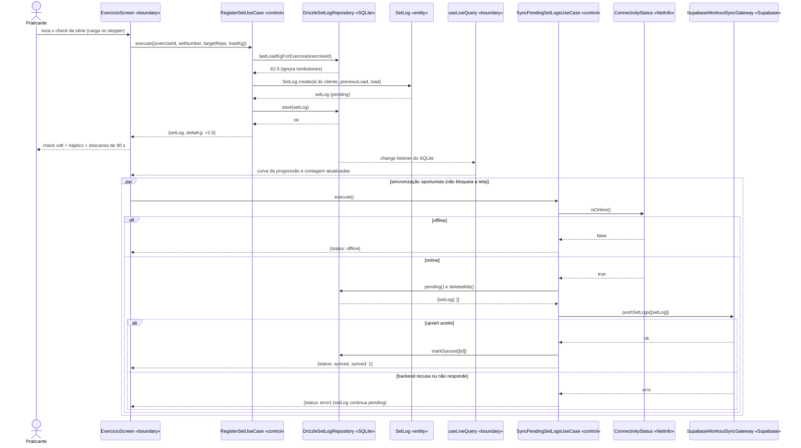
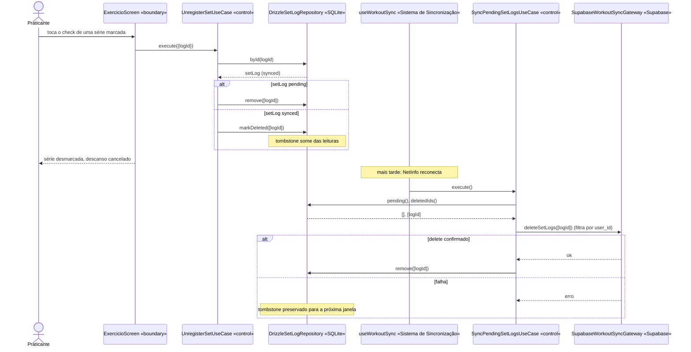
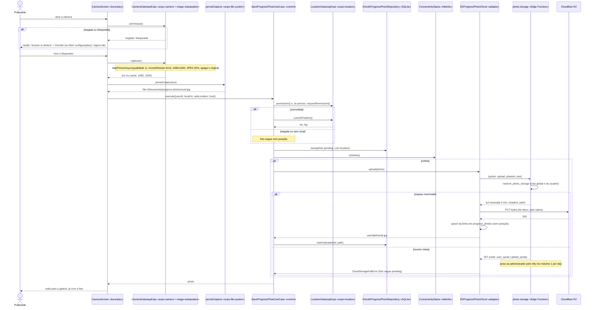
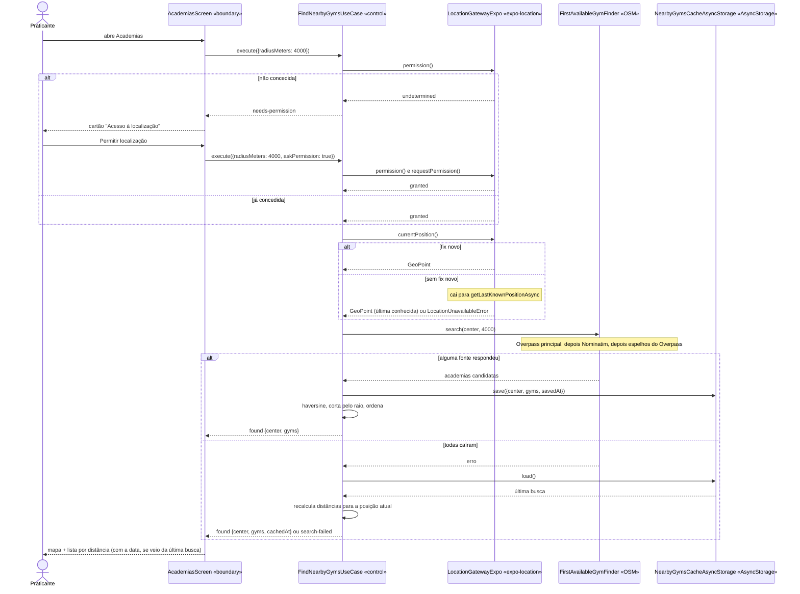
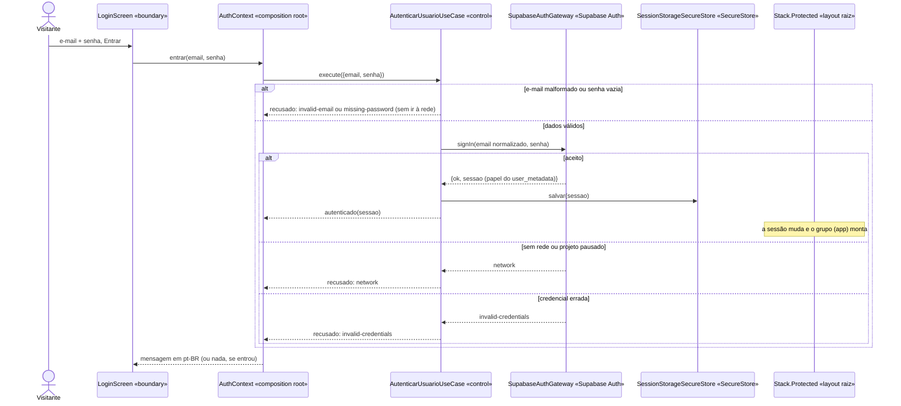
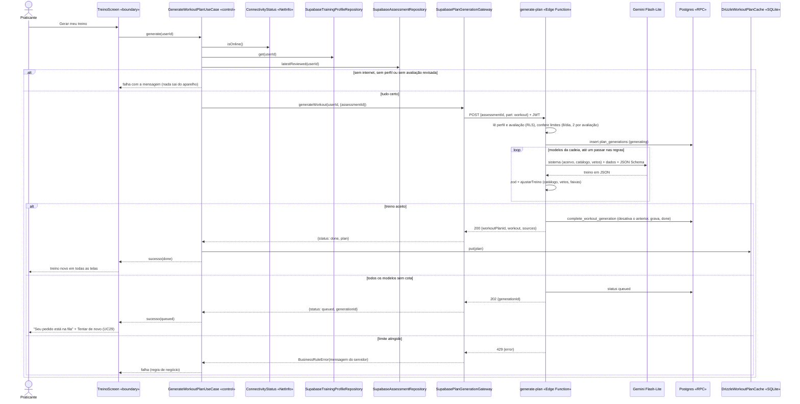
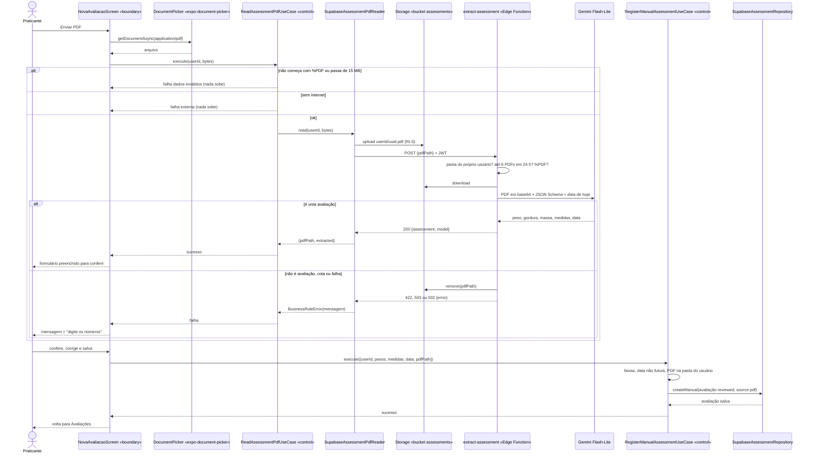
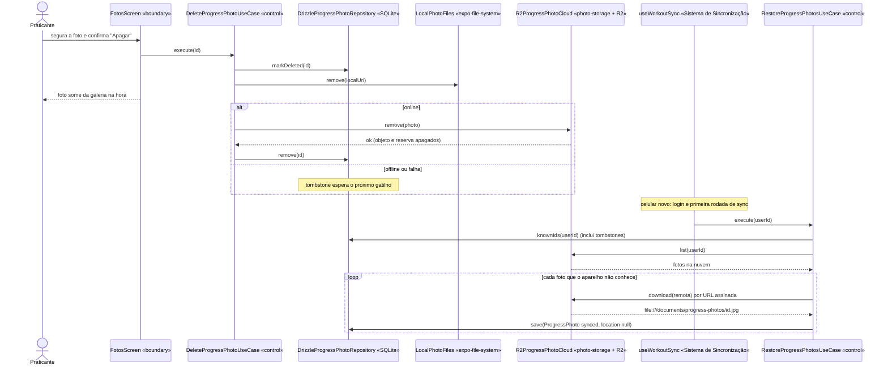

# 7 · Diagramas de Sequência

[← Fronteira, controle e entidade](06-fronteira-controle-entidade.md) · [Índice](README.md) · [Próximo: Atividades →](08-atividades.md)

Os participantes têm os mesmos nomes da tabela da [§6](06-fronteira-controle-entidade.md#tabela-de-mapeamento-por-caso-de-uso), e a ordem das chamadas é a que os testes da [§10](10-implementacao.md) verificam. Toda ação de escrita mostra **dois momentos separados**: (1) a gravação local, síncrona do ponto de vista do usuário e que não falha por falta de rede; (2) a sincronização remota, assíncrona e condicionada à conectividade. As ações que só existem online (gerar plano, ler PDF) mostram o oposto: a conferência no aparelho **antes** de gastar a viagem.

## 7.1 UC07 — Registrar série (offline-first + sincronização)

## 7.2 UC10 + UC21 — Desmarcar série já sincronizada

## 7.3 UC11 — Registrar foto de progresso

## 7.4 UC17 — Encontrar academias por perto

## 7.5 UC01 — Entrar (com falha de rede)

## 7.6 UC26 — Gerar o treino com IA

No pedido de mudança (UC28), o corpo é `{ feedback, part }`. A função lê o treino ativo, usa a avaliação **dele** e, depois de gravar, acrescenta ao perfil os exercícios que a pessoa disse não ter. No "Tentar de novo" (UC29), o corpo é `{ generationId }`, e a função só aceita se o pedido for do mesmo usuário e estiver `queued`. A dieta (UC27) segue a mesma sequência com `part: nutrition`, `ajustarDieta` + `conferirRefeicoes` no lugar de `ajustarTreino` e a RPC `complete_nutrition_generation`. Sem cópia no aparelho, o gateway lê a dieta gravada (`nutrition_plans`) para devolvê-la inteira.

## 7.7 UC25 + UC24 — Avaliação lida do PDF

## 7.8 UC33 + UC34 — Apagar uma foto e restaurar no celular novo

