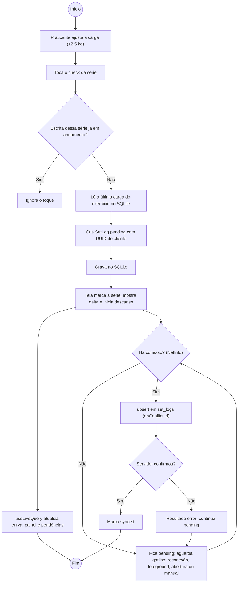
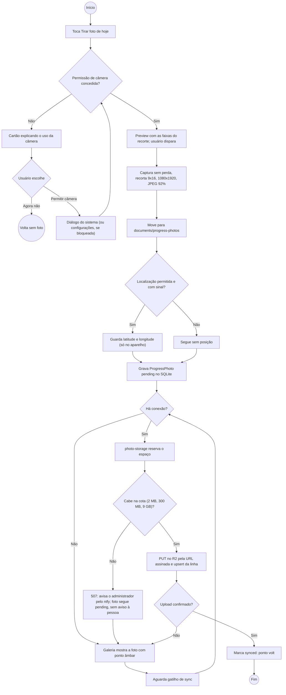
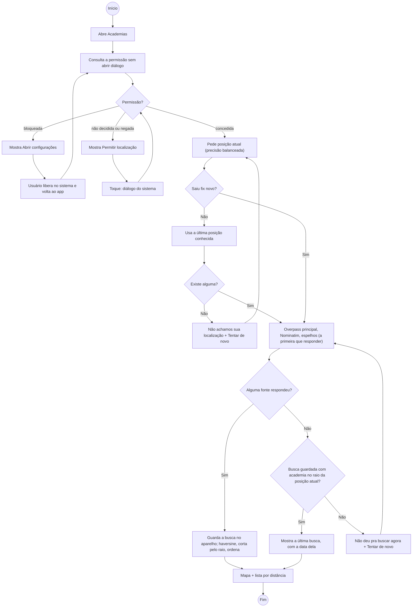
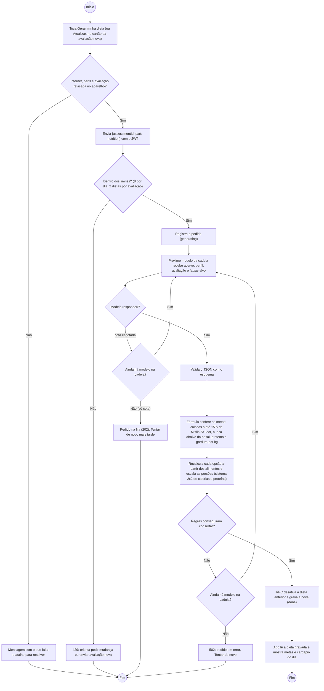
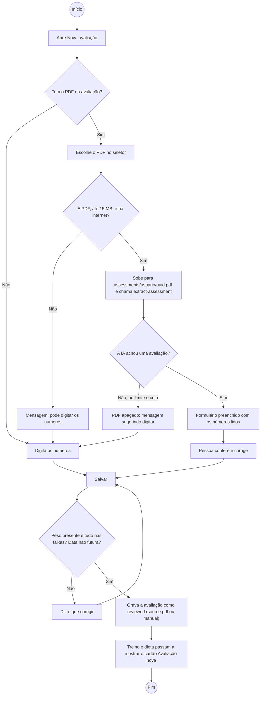
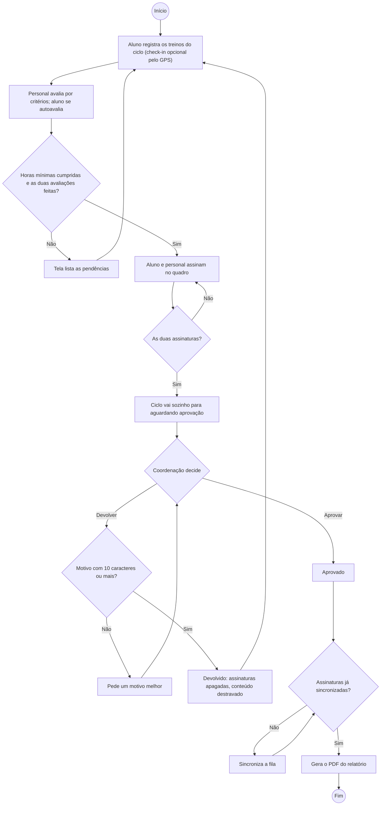

# 8 · Diagramas de Atividades

[← Sequência](07-sequencia.md) · [Índice](README.md) · [Próximo: Componentes →](09-componentes.md)

Um diagrama por processo ponta a ponta. Os dois pontos de ramificação típicos de app mobile, **permissão** e **conectividade**, aparecem explicitamente. Nos processos com IA aparece um terceiro: **a resposta da IA passou nas regras?**

## 8.1 Registrar série e sincronizar (UC07 → UC20)

**Raias.** *Praticante*: ajusta a carga e marca. *App (primeiro plano)*: grava no SQLite, redesenha e dispara o descanso. *Sistema de Sincronização*: tenta o envio agora e em cada gatilho seguinte. *Supabase*: aceita ou recusa o `upsert`.

## 8.2 Registrar foto de progresso (UC11)

**Raias.** *Praticante*: concede permissão e dispara. *App*: captura, ajusta, move o arquivo e grava. *Sistema de Sincronização*: sobe a foto quando houver rede. *Edge Function `photo-storage`* e *Cloudflare R2*.

## 8.3 Encontrar academias (UC17)

**Raias.** *Praticante*: abre a tela e concede permissão. *App*: `FindNearbyGymsUseCase` + `LocationGatewayExpo` + última busca guardada. *GPS do aparelho*. *OpenStreetMap (Overpass e Nominatim)*.

## 8.4 Gerar a dieta (UC27)

**Raias.** *Praticante*: pede a dieta. *App*: `GenerateDietPlanUseCase`. *Edge Function `generate-plan`*: limites, IA e regras. *Gemini*. *Postgres*: RPC que grava tudo ou nada.

O treino (UC26) é o mesmo processo, com outras regras no passo de conferência. Os exercícios precisam existir no catálogo, ficar fora dos vetados (regiões sensíveis e indisponíveis) e não se repetir no dia. O plano precisa ter um dia por dia pedido, e séries, repetições e descanso ficam em faixas sãs. O nome e o grupo muscular vêm do catálogo, não da IA. Depois de gravar, o app guarda a cópia do treino no SQLite.

## 8.5 Registrar a avaliação (UC24 com UC25)

## 8.6 Fechar o relatório do ciclo (UC35 → UC41)

**Raias.** *Aluno*: registra treinos, se autoavalia e assina. *Personal*: avalia e assina. *Coordenação*: aprova ou devolve. *App*: o agregado `CicloAvaliacao` decide o que é permitido; a fila sobe cada item.

Em nenhum desses processos a posição, a falta de rede, a falta de permissão ou uma resposta ruim da IA derruba o app ou prende o usuário. Todo caminho termina num estado com ação possível: repetir, sair, abrir configurações, digitar à mão ou tentar depois. É o RNF02/RNF03 visto como fluxo.
