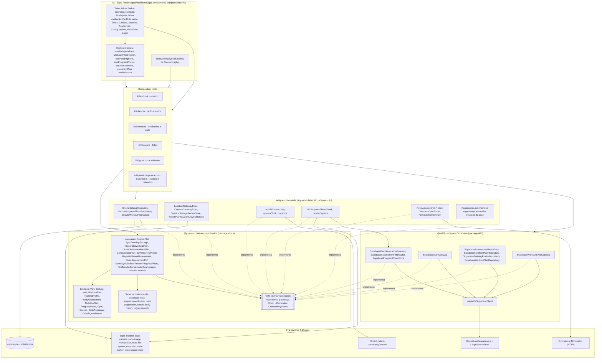
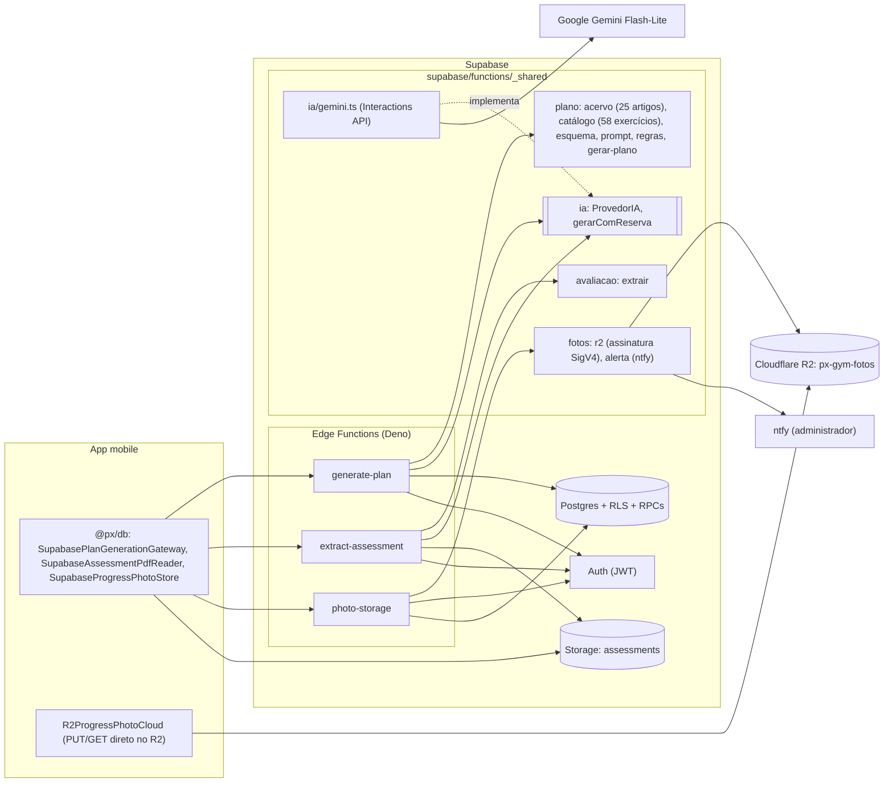

# 9 · Diagrama de Componentes

[← Atividades](08-atividades.md) · [Índice](README.md) · [Próximo: Implementação →](10-implementacao.md)

Esta é a visão estrutural do monorepo, a materialização das camadas da [§10](10-implementacao.md). As setas apontam de quem depende para quem é dependido.

## 9.1 O aplicativo mobile

## 9.2 O servidor

O desenho do servidor repete o do app em pequeno. `ProvedorIA` é o port da IA: `generate-plan` e `extract-assessment` só conhecem ele, e trocar de modelo ou de empresa é escrever outro adapter no lugar de `gemini.ts`. As regras (`regras.ts`) não importam o provedor, e os testes Deno as exercitam com um provedor falso. O Deno não importa o workspace `@px/core`, por isso os esquemas e o catálogo vivem em `_shared` e espelham os tipos do core. As faixas do perfil, por exemplo, estão nos três lugares (banco, função e caso de uso) com a mesma regra.

## Regras de leitura (e como são garantidas)

| Regra | Situação | Como conferir (da raiz) |
|---|---|---|
| `Core` não tem seta saindo para `Adapters`/`Infra` | **Cumprida**: `packages/core/src` não importa nenhum pacote externo | `grep -rhoE 'from "[^".][^"]*"' packages/core/src` não retorna nada |
| Telas não fazem SQL nem chamam o Supabase | **Cumprida**: leituras reativas moram em `lib/use-*.ts`, leituras remotas em `lib/remote.ts` e `lib/plans.ts` | `grep -rlE 'from "(drizzle-orm\|@/db)' apps/mobile/src/app` → só `_layout.tsx` (migrations no boot); `grep -rlE 'supabase\|@px/db' apps/mobile/src/app apps/mobile/src/adapters/screens` → nada |
| `expo-*` nas telas só onde é UI ou entrada do usuário | **Cumprida**, com exceções justificadas: `expo-camera` (preview `<CameraView>` na câmera e no scanner), `expo-document-picker` e `expo-file-system` (a Nova avaliação lê os bytes do PDF escolhido), `expo-haptics`, `expo-image`, `expo-constants` (versão) | `grep -rhoE 'from "expo-[a-z-]+"' apps/mobile/src/app \| sort \| uniq -c` |
| O "onde SQLite e Supabase se encontram" é um lugar só por assunto | **Cumprida**: os composition roots de `apps/mobile/src/lib` e `apps/mobile/src/adapters/composicao.ts` | leitura de `workout.ts`, `plans.ts`, `photos.ts` |
| Chaves de servidor fora do app | **Cumprida**: `GEMINI_API_KEY`, `R2_*`, `NTFY_TOPIC` e `service_role` só como *secrets* das Edge Functions | `grep -rn "GEMINI\|R2_\|service_role" apps/mobile/src` → nada |

## Detalhes por plataforma e por modo

- **Mapa**: `gym-map.tsx` (iOS, Apple Maps via `react-native-maps`, sem chave) e `gym-map.android.tsx` (MapLibre + tiles raster do OSM, carregado sob demanda para não derrubar o Expo Go). O Metro escolhe pela extensão, sem nenhum `if (Platform.OS)` na tela.
- **Modo mock** (`EXPO_PUBLIC_MODO_MOCK=1`, em `lib/modo.ts`): o SQLite e o cliente Supabase viram `desligadoNoMock` (um `Proxy` que lança ao uso), as migrations e o `useWorkoutSync` não rodam, o login é por `AuthGatewayStub` com contas de demonstração, e o GPS e as fotos são simulados. Na navegação ficam só Relatórios e Fotos; o resto sai pelo `Drawer.Protected`. O padrão é o modo real.
- **Web (`apps/web`)**: fala com o mesmo projeto Supabase, mas **não** importa nenhum pacote `@px/*` (tem cliente, tipos e regras próprios) e ainda usa o pipeline antigo de PDF → Claude, que depende de chave paga. Ver [lacunas](10-implementacao.md#lacunas-e-próximos-passos).
